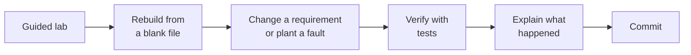

# 100 Days of Networking

I work in IT helpdesk and I'm moving into network and network security engineering. This repo is 100 days of hands-on practice: I refresh CCNA skills by rebuilding and breaking guided labs, design my own scenarios, and finish with a campus network built in stages and tested against failures. Every result links to the evidence behind it.

**Miguel** · Salt Lake City · [LinkedIn](https://www.linkedin.com/in/migyuelito/) · [Email](mailto:migyuelito@outlook.com)

> [!NOTE]
> **Progress:** Day 1 of 100 · Phase {{PHASE}} · Last updated 2026-11-09

## For reviewers

| Time you have | Where to look |
|---|---|
| 2 minutes | [Featured projects](#featured-projects): what each one proves, with links to the tests |
| 10 minutes | One project summary, then its results table |
| More | The [daily log](#daily-log): what I built, changed, broke, and verified each day |

## Featured projects

<!-- Mark a project Complete only when its summary, report, and evidence are pushed. Everything else stays Planned or In progress. -->

| Project | What it shows | Evidence | Status |
|---|---|---|---|
| {{PROJECT_NAME}} | {{One line, e.g., "Guest isolation with ACLs, proved by permit and deny tests"}} | [Summary](projects/{{PROJECT_FOLDER}}/README.md) · [Report](projects/{{PROJECT_FOLDER}}/report.md) | {{STATUS}} |
| Campus network build | Employee, guest, server, and management networks with redundant links and outage tests | — | Planned (Days 81–100) |

## How I work

Each day follows the same loop, so the evidence is consistent from day to day:

Every entry labels what I did on my own:

| Label | Meaning |
|---|---|
| **Guided** | Followed the course lab |
| **Rebuilt** | Built it again from a blank file, without the video |
| **Changed** | Added or changed a requirement the course didn't ask for |
| **Diagnosed** | Found and fixed a fault |
| **Original** | My own scenario, with no course lab behind it |

## Roadmap

| Phase | Days | Focus | Status |
|---|---|---|---|
| 1 | 1–60 | CCNA refresh: guided lab, rebuild, change or fault, verify | **In Progress** |
| 2 | 61–80 | Original scenarios combining switching, routing, services, and ACLs | Planned |
| 3 | 81–100 | Campus network built in stages, with outage testing | Planned |
| Optional | 101–365 | Advanced routing, security, automation, network operations | Planned |

Pacing, scenario ideas, and the campus test plan: [docs/roadmap.md](docs/roadmap.md)

## Daily log

<!-- One row per day, newest at the bottom. "My work" uses the labels above. -->

| Day | Date | Topic | Source | My work | Evidence |
|---|---|---|---|---|---|
| [001](days/day-001/README.md) | 2026-11-9 | Packet Tracer setup · the subnet boundary | Jeremy's IT Lab Day 1 + Day 1 Lab | **Guided** | [Files](days/day-001/evidence/) |

## Skills map

<!-- Add links as the evidence exists. Leave a row empty rather than guess. -->

| Skill | Where to see it |
|---|---|
| VLANs and trunking | |
| Routing (static, OSPF) | |
| ACLs and segmentation | |
| DHCP, DNS, NTP, syslog | |
| Redundancy (STP, EtherChannel, HSRP) | |
| Troubleshooting | |

## Tools

Cisco Packet Tracer 9.0.1 · Git and GitHub · Draw.io

## Sources and attribution

Guided labs follow Jeremy's IT Lab's [Free CCNA 200-301 Complete Course](https://www.youtube.com/playlist?list=PLxbwE86jKRgMpuZuLBivzlM8s2Dk5lXBQ). Course lab files aren't in this repo; each guided day links to its lesson instead. Rebuilds, configs, test evidence, and write-ups are my own unless a file says otherwise. Details: [ATTRIBUTION.md](ATTRIBUTION.md)
