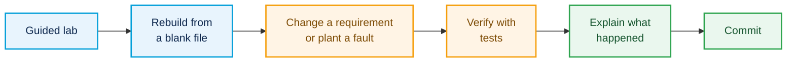

# 🌐 100 Days of Networking

**100 days of hands-on labs: CCNA refresh → original scenarios → a campus network tested against failures**

**Miguel** · United States · [LinkedIn](https://www.linkedin.com/in/migyuelito/) · [Email](mailto:migyuelito@outlook.com)

I work in IT helpdesk and I'm moving into network and network security engineering. This repo is 100 days of hands-on practice: I refresh CCNA skills by rebuilding and breaking guided labs, design my own scenarios, and finish with a campus network built in stages and tested against failures. Every result links to the evidence behind it.

> [!NOTE]
> **Progress:** Day 4 of 100 · Phase 1 · Last updated 2026-11-12

## 👀 For Reviewers

| ⏱️ Time you have | 📍 Where to look |
|:--|:--|
| **2 minutes** | [Featured projects](#-featured-projects): what each one proves, with links to the tests |
| **10 minutes** | One project summary, then its results table |
| **More** | The [daily log](#-daily-log): what I built, changed, broke, and verified each day |

## ⭐ Featured Projects

<!-- Mark a project Complete only when its summary, report, and evidence are pushed. Everything else stays Planned or In progress. -->
<!-- Row format: | Project name | One line on what it proves | [Summary](projects/FOLDER/README.md) · [Report](projects/FOLDER/report.md) | 🗓️ Planned · 🚧 In progress · ✅ Complete | -->

| Project | What it shows | Evidence | Status |
|:--|:--|:--|:--|
| **Campus&nbsp;network&nbsp;build** | Employee, guest, server, and management networks with redundant links and outage tests | — | 🗓️&nbsp;Planned Days&nbsp;81–100 |

## 🛠️ How I Work

Each day follows the same loop, so the evidence is consistent from day to day:

Every entry labels what I did on my own:

| Label | Meaning |
|:--|:--|
| 📘 **Guided** | Followed the course lab |
| 🔁 **Rebuilt** | Built it again from a blank file, without the video |
| ✏️ **Changed** | Added or changed a requirement the course didn't ask for |
| 🩺 **Diagnosed** | Found and fixed a fault |
| 💡 **Original** | My own scenario, with no course lab behind it |

## 🧭 Roadmap

| Phase | Focus | Status |
|:--|:--|:--|
| **Phase 1** Days 1–60 | CCNA refresh: guided lab, rebuild, change or fault, verify | 🚧 **In progress** |
| **Phase 2** Days 61–80 | Original scenarios combining switching, routing, services, and ACLs | 🗓️ Planned |
| **Phase 3** Days 81–100 | Campus network built in stages, with outage testing | 🗓️ Planned |
| **Optional** Days 101–365 | Advanced routing, security, automation, network operations | 🗓️ Planned |

Pacing, scenario ideas, and the campus test plan: [docs/roadmap.md](docs/roadmap.md)

## 📅 Daily Log

<!-- One row per day, newest at the bottom. "My work" uses the labels above. -->

| Day | Date | Topic | Source | My work | Evidence |
|:--:|:--|:--|:--|:--|:--|
| [**001**](days/day-001/README.md) | 2026-11-09 | Network devices | Jeremy's IT Lab Day 1 + Day 1 Lab | 📘 **Guided** | 📁 [Files](days/day-001/evidence/) |
| [**002**](days/day-002/README.md) | 2026-11-10 | Interfaces and cables | Jeremy's IT Lab Day 2 + Day 2 Lab | 📘 **Guided** | 📁 [Files](days/day-002/evidence/) |
| [**003**](days/day-003/README.md) | 2026-11-11 | The TCP/IP model | Jeremy's IT Lab Day 3 + Day 3 Lab | 📘 **Guided** | 📁 [Files](days/day-003/evidence/) |
| [**004**](days/day-004/README.md) | 2026-11-12 | Intro to the CLI | Jeremy's IT Lab Day 4 + Day 4 Lab | 📘 **Guided** | 📁 [Files](days/day-004/evidence/) |
| [**005**](days/day-005/README.md) | 2026-11-13 | Ethernet LAN switching | Jeremy's IT Lab Day 5 + Day 5 Lab | 📘 **Guided** | 📁 [Files](days/day-005/evidence/) |

## 🧠 Skills Map

<!-- Add links as the evidence exists. Leave a row empty rather than guess. -->

| Skill | Where to see it |
|:--|:--|
| 🏷️ VLANs and trunking | — |
| 🗺️ Routing (static, OSPF) | — |
| 🚦 ACLs and segmentation | — |
| 📦 DHCP, DNS, NTP, syslog | — |
| 🛟 Redundancy (STP, EtherChannel, HSRP) | — |
| 🔍 Troubleshooting | — |

## 🧰 Tools

## 📜 Sources and Attribution

Guided labs follow Jeremy's IT Lab's [Free CCNA 200-301 Complete Course](https://www.youtube.com/playlist?list=PLxbwE86jKRgMpuZuLBivzlM8s2Dk5lXBQ). Course lab files aren't in this repo; each guided day links to its lesson instead. Rebuilds, configs, test evidence, and write-ups are my own unless a file says otherwise. Details: [ATTRIBUTION.md](ATTRIBUTION.md)

---

**[⬆ Back to top](#readme-top)**

