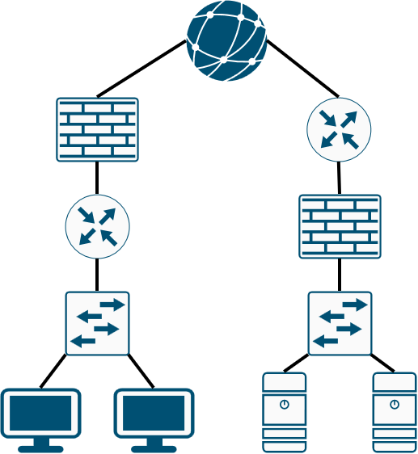

# 💻 Day 001 — Packet Tracer Introduction · Network Devices

**Setting up Packet Tracer and rebuilding a topology of routers, switches, firewalls, and end hosts**

| 📅 Date | ⏱️ Time spent | 📚 Source | 🛠️ Work type |
|---|---|---|---|
| 2026-11-09 | 5 min | Jeremy's IT Lab, Free CCNA Day 1 (Network Devices) Day 1 Lab (Packet Tracer Introduction) ▶️ [Playlist](https://www.youtube.com/playlist?list=PLxbwE86jKRgMpuZuLBivzlM8s2Dk5lXBQ) | Guided · Rebuilt |

<!-- Aim for 10 minutes of writing. Copy this file to days/day-NNN/README.md. -->

> 🎯 **Goal:** Set up Packet Tracer, rebuild the Day 1 topology from memory.

## 📋 What I Did

- [x] **Guided:** Followed lab instructions of recreating network diagram
- [x] **Rebuilt** the topology from a blank file, without the video instruction → `day-001-rebuild.pkt`

## 🗺️ Topology

  

## 🧠 Key Takeaways

| Device | In this topology | Role |
|:--|:--:|:--|
| 🌐 Internet | 1 | The outside network both sites connect to |
| 🧱 Firewall | 2 | Filters traffic in and out based on security rules |
| 🧭 Router | 2 | Connects separate networks and forwards packets between them |
| 🔀 Switch | 2 | Connects end hosts within the same LAN |
| 🖥️ PC | 2 | Client: an end host that uses network services |
| 🗄️ Server | 2 | An end host that provides services to clients |

> [!TIP]
> The two sites place the firewall differently: the left site puts it **in front of** the router, and the right site puts it **behind** the router.

## 💡 What Happened and Why

Limited testing and configuration for this specific day, as it is used as a general start and introduction to Packet Tracer and the many networking symbols and connections.

---

**Next:** [Day 002 · Interfaces & Cables](https://github.com/migyuelito/100-days-of-networking/blob/main/days/day-002/README.md) ➡️

**[⬆ Back to top](#readme-top)**

