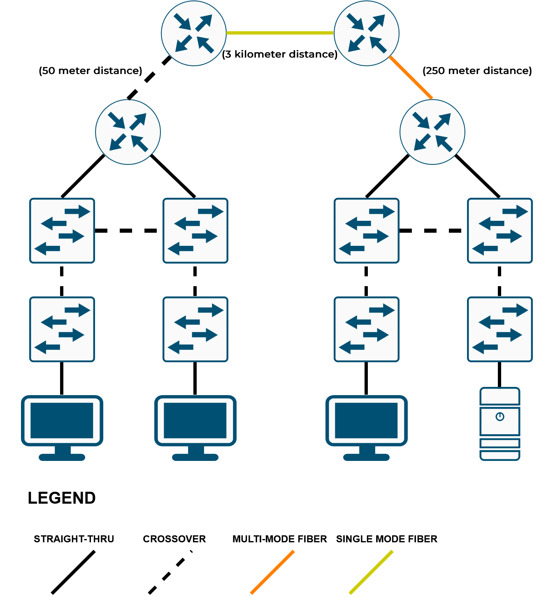

# 💻 Day 002 — Interfaces and Cables

**Connecting devices with the right copper or fiber cable for each link**

| 📅 Date | ⏱️ Time spent | 📚 Source | 🛠️ Work type |
|---|---|---|---|
| 2026-11-10 | 10 min | Jeremy's IT Lab, Free CCNA Day 2 (Interfaces and Cables) Day 2 Lab (Connecting Devices) ▶️ [Playlist](https://www.youtube.com/playlist?list=PLxbwE86jKRgMpuZuLBivzlM8s2Dk5lXBQ) | Guided · Rebuilt |

<!-- Aim for 10 minutes of writing. Copy this file to days/day-NNN/README.md. -->

> 🎯 **Goal:** Connect networking devices together with the proper cables.

## 📋 What I Did

- [x] **Guided:** Followed lab instructions of connecting devices together

## 🗺️ Topology

  

## 🧠 Key Takeaways

| Cable | In the diagram | Used here for |
|:--|:--|:--|
| Straight-through (copper) | Solid black line | Different device types: router ↔ switch, switch ↔ PC or server |
| Crossover (copper) | Dashed black line | Same device types: switch ↔ switch, and router ↔ router over 50 m |
| Multimode fiber | Orange line | Router ↔ router over 250 m |
| Single-mode fiber | Yellow line | Router ↔ router over 3 km |

> [!TIP]
> Copper Ethernet tops out at 100 m, which is why the 250 m and 3 km links use fiber, and the longest link uses single-mode.

## 💡 What Happened and Why

Day 2 of Jeremy's IT Lab labs. Getting through most of the introductory lessons without a sweat. Mainly getting used to GitHub and how to contribute and add to repos.

---

⬅️ **Previous:** [Day 001 · Network Devices](https://github.com/migyuelito/100-days-of-networking/blob/main/days/day-001/README.md) &nbsp;&nbsp;•&nbsp;&nbsp; **Next:** [Day 003 · The TCP/IP Model](https://github.com/migyuelito/100-days-of-networking/blob/main/days/day-003/README.md) ➡️

**[⬆ Back to top](#readme-top)**

