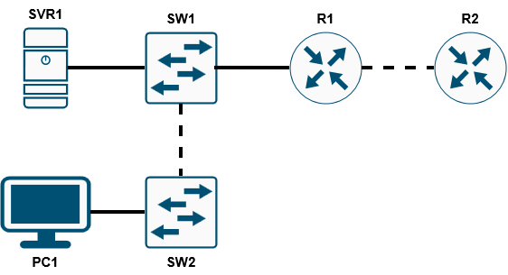
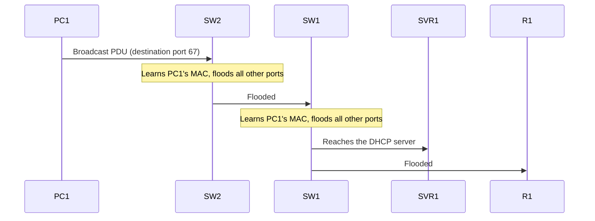

# 💻 Day 003 — The TCP/IP Model

**Following a broadcast through the OSI layers in Packet Tracer's simulation mode**

| 📅 Date | ⏱️ Time spent | 📚 Source | 🛠️ Work type |
|---|---|---|---|
| 2026-11-11 | 10 min | Jeremy's IT Lab, Free CCNA Day 3 (The TCP/IP Model) Day 3 Lab (OSI Model) ▶️ [Playlist](https://www.youtube.com/playlist?list=PLxbwE86jKRgMpuZuLBivzlM8s2Dk5lXBQ) | Guided · Rebuilt |

<!-- Aim for 10 minutes of writing. Copy this file to days/day-NNN/README.md. -->

> 🎯 **Goal:** Reviewing the OSI model by analyzing traffic content of each payload.

## 📋 What I Did

- [x] **Guided:** Followed lab instructions of sending and analysing traffic with Packet Tracer simulation mode.

## 🗺️ Topology

  

## 💡 What Happened and Why

Day 3 of Jeremy's IT Lab labs.

### Step 1 — Creating traffic on the client, releasing PC1's IP address

Traffic is created with some destination information:

| OSI layer | Field | Value | Meaning |
|:--|:--|:--|:--|
| 2 · Data link | Destination MAC | `FFFF.FFFF.FFFF` | Broadcast: every device on the LAN |
| 3 · Network | Destination IP | `255.255.255.255` | Broadcast: every host on the local network |
| 4 · Transport | Destination port | `67` | DHCP server |

### Step 2 — PDU is sent through the wire to SVR1

SW2 and SW1 receive the PDU. Each one saves PC1's MAC address to its MAC address table under the associated port, then forwards the PDU to all other ports due to it being a broadcast.

---

⬅️ **Previous:** [Day 002 · Interfaces and Cables](https://github.com/migyuelito/100-days-of-networking/blob/main/days/day-002/README.md) &nbsp;&nbsp;•&nbsp;&nbsp; **Next:** [Day 004 · Intro to the CLI](https://github.com/migyuelito/100-days-of-networking/blob/main/days/day-004/README.md) ➡️

**[⬆ Back to top](#readme-top)**

