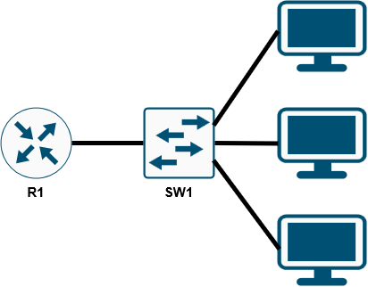

<div align="center">

# 💻 Day 004 — Intro to the CLI

**Navigating the Cisco IOS CLI and securing privileged EXEC mode on a router and switch**

[](https://github.com/migyuelito/100-days-of-networking)


| 📅 Date | ⏱️ Time spent | 📚 Source | 🛠️ Work type |
|---|---|---|---|
| 2026-11-12 | 10 min | Jeremy's IT Lab, Free CCNA<br>Day 4 (Intro to the CLI) and Day 4 Lab (Device Security)<br>▶️ [Playlist](https://www.youtube.com/playlist?list=PLxbwE86jKRgMpuZuLBivzlM8s2Dk5lXBQ) | Guided · Rebuilt |

</div>

<!-- Aim for 10 minutes of writing. Copy this file to days/day-NNN/README.md. -->

> 🎯 **Goal:** Learning the basics of the Cisco IOS CLI and securing privileged EXEC mode with passwords and encryption.

## 📋 What I Did

- [x] **Guided:** Followed the Day 4 lab instructions in Packet Tracer to set hostnames, configure and encrypt enable passwords, and save the configuration on R1 and SW1.

## 🗺️ Topology

<p align="center">
  
</p>

| Device | Hostname | Enable password | Enable secret |
|:--|:--:|:--:|:--:|
| Router | `R1` | `CCNA` | `Cisco` |
| Switch | `SW1` | `CCNA` | `Cisco` |

## 🧭 CLI Modes

The three IOS modes used in this lab, and the commands that move between them:


## ✅ Lab Tasks

- [x] [**Task 1**](#task-1--change-the-hostnames) — Change the hostnames of the router and switch to the appropriate names (`R1`, `SW1`)
- [x] [**Task 2**](#task-2--set-an-unencrypted-enable-password) — Configure an unencrypted enable password of `CCNA` on both devices
- [x] [**Task 3**](#task-3--test-the-password) — Exit back to user EXEC mode and test the password
- [x] [**Task 4**](#task-4--view-the-plain-text-password) — View the password in the running configuration
- [x] [**Task 5**](#task-5--encrypt-all-passwords) — Ensure that the current password and all future passwords are encrypted
- [x] [**Task 6**](#task-6--view-the-encrypted-password) — View the password in the running configuration
- [x] [**Task 7**](#task-7--set-an-enable-secret) — Configure a more secure, encrypted enable password of `Cisco` on both devices
- [x] [**Task 8**](#task-8--test-which-password-works) — Exit back to user EXEC mode and then return to privileged EXEC mode
- [x] [**Task 9**](#task-9--compare-the-encryption-types) — View the passwords in the running configuration
- [x] [**Task 10**](#task-10--save-the-configuration) — Save the running configuration to the startup configuration

## 🏷️ Part 1 — Hostnames

### Task 1 — Change the hostnames

> Change the hostnames of the router and switch to the appropriate names (**R1**, **SW1**).

💡 **My solution:** Enter `configure terminal` and use the `hostname` command.

```
Router# configure terminal
Router(config)# hostname R1
R1(config)#                         ← the prompt updates instantly

Switch# configure terminal
Switch(config)# hostname SW1
SW1(config)#
```

## 🔑 Part 2 — Enable Password

### Task 2 — Set an unencrypted enable password

> Configure an unencrypted enable password of **CCNA** on both devices.

💡 **My solution:** In `configure terminal`, use the `enable password` command and enter `CCNA`.

```
R1(config)# enable password CCNA
SW1(config)# enable password CCNA
```

### Task 3 — Test the password

> Exit back to user EXEC mode and test the password.

```
R1(config)# end
R1# disable
R1> enable
Password:                           ← type CCNA (input is hidden)
R1#
```

### Task 4 — View the plain-text password

> View the password in the running configuration.

💡 **My solution:** Verified and confirmed the password using `show running-config`. It's stored in **plain text**, readable by anyone who can see the config.

```
R1# show running-config
...
hostname R1
!
enable password CCNA
...
```

## 🔒 Part 3 — Password Encryption

### Task 5 — Encrypt all passwords

> Ensure that the current password and all future passwords are encrypted.

💡 **My solution:** In `configure terminal`, use the `service password-encryption` command to encrypt current and future passwords.

```
R1(config)# service password-encryption
SW1(config)# service password-encryption
```

### Task 6 — View the encrypted password

> View the password in the running configuration.

Before ➜ after: the password is no longer readable. It's now stored as a **Type 7** encrypted string.

```diff
  R1# show running-config
- no service password-encryption
+ service password-encryption
  !
  hostname R1
  !
- enable password CCNA
+ enable password 7 08026F6028
```

## 🛡️ Part 4 — Enable Secret

### Task 7 — Set an enable secret

> Configure a more secure, encrypted enable password of **Cisco** on both devices.

💡 **My solution:** In `configure terminal`, use the `enable secret` command and enter `Cisco`.

```
R1(config)# enable secret Cisco
SW1(config)# enable secret Cisco
```

### Task 8 — Test which password works

> Exit back to user EXEC mode and then return to privileged EXEC mode.

```
R1(config)# end
R1# disable
R1> enable
Password:                           ← CCNA is rejected now; Cisco works
R1#
```

> [!NOTE]
> **Which password do you have to use?**
>
> ➜ The more secure **`Cisco`** password. When both are configured, `enable secret` always takes precedence over `enable password`.

### Task 9 — Compare the encryption types

> View the passwords in the running configuration.

```
R1# show running-config
...
enable secret 5 $1$mERr$YlCkLMcTYWwkF1Ccndtll.
enable password 7 08026F6028
...
```

> [!NOTE]
> **What encryption type number is used for the encrypted enable password?**
>
> ➜ Password encryption for the enable password is **Type 7**.
>
> **What encryption type number is used for the encrypted enable secret?**
>
> ➜ The enable secret uses **Type 5 (MD5)** in this configuration.

## 💾 Part 5 — Save the Configuration

### Task 10 — Save the configuration

> Save the running configuration to the startup configuration.

💡 **My solution:** Use `write memory` to save the running configuration to the startup configuration.

```
R1# write memory
Building configuration...
[OK]
```

> [!TIP]
> `copy running-config startup-config` does the same job. Skip this step and every change above is lost on the next reload.

## 🧠 Key Takeaways

| | 🔓 `enable password` | 🔐 `enable secret` |
|:--|:--|:--|
| **Stored as** | Plain text by default | Always hashed |
| **Type in this lab** | Type 7 (after `service password-encryption`) | Type 5 (MD5) |
| **Reversible?** | ⚠️ Yes, Type 7 is easily decoded | 🛡️ No, it's a one-way hash |
| **If both are set** | Ignored | ✅ Used |

> [!IMPORTANT]
> `service password-encryption` only applies weak Type 7 encryption, which can be reversed in seconds. Always use `enable secret` to protect privileged EXEC mode.

## 📚 Command Cheat Sheet

| Command | Mode | Purpose |
|:--|:--|:--|
| `enable` | User EXEC | Enter privileged EXEC mode |
| `configure terminal` | Privileged EXEC | Enter global configuration mode |
| `hostname <name>` | Global config | Set the device hostname |
| `enable password <password>` | Global config | Set an unencrypted enable password |
| `service password-encryption` | Global config | Encrypt current and future plain-text passwords (Type 7) |
| `enable secret <password>` | Global config | Set a hashed enable password (Type 5 in this lab) |
| `end` | Any config mode | Return to privileged EXEC mode |
| `disable` | Privileged EXEC | Return to user EXEC mode |
| `show running-config` | Privileged EXEC | Display the current configuration |
| `write memory` | Privileged EXEC | Save the running config to the startup config |

## 📝 Synopsis

Day 4 of Jeremy's IT Lab labs.

First true day of getting into the command line. A lot of the information I already knew.

---

<div align="center">

⬅️ **Previous:** [Day 003 · The TCP/IP Model](https://github.com/migyuelito/100-days-of-networking/blob/main/days/day-003/README.md) &nbsp;&nbsp;•&nbsp;&nbsp; **Next:** [Day 005 · Ethernet LAN Switching](https://github.com/migyuelito/100-days-of-networking/blob/main/days/day-005/README.md) ➡️

**[⬆ Back to top](#-day-004--intro-to-the-cli)**

</div>
