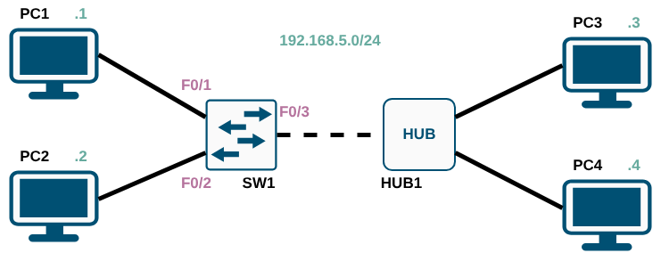
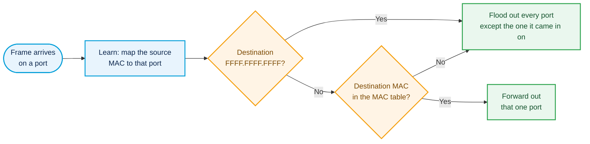

<div align="center">
<a id="readme-top"></a>

# 💻 Day 005 — Ethernet LAN Switching, Part 1

**A switch next to a hub: watching frames get learned, flooded, forwarded, and repeated**

[](https://github.com/migyuelito/100-days-of-networking)


| 📅 Date | ⏱️ Time spent | 📚 Source | 🛠️ Work type |
|---|---|---|---|
| {{YYYY-MM-DD}} | {{TIME}} | Jeremy's IT Lab, Free CCNA<br>Day 5 (Ethernet LAN Switching pt. 1)<br>Custom lab written with Claude (the course has no Day 5 lab)<br>▶️ [Playlist](https://www.youtube.com/playlist?list=PLxbwE86jKRgMpuZuLBivzlM8s2Dk5lXBQ) | Guided |

</div>

<!-- Aim for 10 minutes of writing. Copy this file to days/day-NNN/README.md. -->
<!-- Pre-drafted lab: replace each double-curly-brace placeholder with what you did and saw, tick the tasks you finish, and delete anything you skip. -->

> 🎯 **Goal:** Watch a switch learn, flood, and forward frames next to a hub that just repeats them, and read the fields of an Ethernet frame.

## 📋 What I Did

- [x] **Guided:** Built the custom Day 5 lab in Packet Tracer and worked through its tasks in Simulation mode.

## 🗺️ Topology

<p align="center">
  
</p>

No default gateways; there's no router in this design.

| Host | Address | Mask | Connects to |
|:--|:--|:--|:--|
| PC1 | 192.168.5.1 | 255.255.255.0 | SW1 F0/1 |
| PC2 | 192.168.5.2 | 255.255.255.0 | SW1 F0/2 |
| PC3 | 192.168.5.3 | 255.255.255.0 | HUB1 (any port) |
| PC4 | 192.168.5.4 | 255.255.255.0 | HUB1 (any port) |

SW1 F0/3 connects to HUB1.

> [!TIP]
> **Why a hub?** Hubs are obsolete, and that's the point. This is the Day 6 topology with SW2 swapped for a hub. A hub repeats every frame out every port; a switch learns where each device is and sends a frame only where it needs to go. Side by side, the switch's decisions are easy to see.

## 🧭 How a Switch Decides

Every frame that reaches SW1 goes through the same steps. HUB1 skips all of them and repeats the frame out every other port.



## ✅ Lab Tasks

- [x] [**Task 1**](#task-1--build-and-cable-the-topology) — Build and cable the topology
- [x] [**Task 2**](#task-2--configure-sw1-and-address-the-pcs) — Configure SW1 the Day 4 way and address the PCs
- [x] [**Task 3**](#task-3--record-each-pcs-mac-address) — Record each PC's MAC address
- [x] [**Task 4**](#task-4--send-a-frame-through-the-hub) — Send a frame through the hub

## 🔌 Part 1 — Build the LAN

### Task 1 — Build and cable the topology

> Recreate the topology provided by Claude in Packet Tracer.

💡 **My solution:** Added one 2960 switch, one hub, and four PC's, renamed them to match the topology and cabled them appropriately.

> [!NOTE]
> ➜ The connection from SW1 to HUB1 requires a crossover cable due to both devices transmitting using pins 3-6.

### Task 2 — Configure SW1 and address the PCs

> Set the switch's hostname, protect privileged EXEC mode, and save the configuration. Then provide each PC its address from the table (no default gateway).

💡 **My Commands:**
```
Switch>
Switch>en
Switch#conf t
Enter configuration commands, one per line.  End with CNTL/Z.
Switch(config)#hostname SW1
SW1(config)#enable secret Cisco1
SW1(config)#do write memory
Building configuration...
[OK]
SW1(config)#
```

💡 **My Solution:**
PC addresses: Clickd on each individual PC and manually configured the IPv4 address and subnet.

### Task 3 — Record each PC's MAC address

> Find each PC's MAC address, fill in the table, and pick out the OUI.

🛠️ Click the PC → **Desktop** → **Command Prompt** → `ipconfig /all`, and read **Physical Address**.

| PC | MAC address | OUI (first 6 hex digits) |
|:--|:--|:--|
| PC1 | 00D0.58A1.5E10 | 00D0.58 |
| PC2 | 00D0.D35A.A031 | 00D0.D3 |
| PC3 | 0090.0C11.A512 | 0090.0C |
| PC4 | 0090.2BB5.9D79 | 0090.2B |

> [!NOTE]
> ➜ The OUI identifies the manufacturers or vendor of the NIC of the device.

## ⚖️ Part 2 — Switch vs. Hub

### Task 4 — Send a frame through the hub

> Switch to Simulation mode and send one ping from PC3 to PC1. Step through the first frame until it leaves HUB1.

> [!NOTE]
> **What did HUB1 do with the frame, and which OSI layer did it work at? (Check HUB1's OSI Model tab.)**
>
> ➜ HUB1 broadcasted the frame to all of its ports. Hubs work primarily within the Physical layer of the OSI Model.
>
> **Try the Inspect tool on HUB1. Does it have a MAC table? Why or why not?**
>
> ➜ Hubs do not have a MAC table as they are not smart devices and only broadcast out traffic.

## 🔍 Part 3 — Anatomy of an Ethernet Frame

## 🧠 Key Takeaways

### Switch vs. hub

| | 🔁 Hub | 🔀 Switch |
|:--|:--|:--|
| **OSI layer** | Layer 1: repeats bits | Layer 2: reads frames and MAC addresses |
| **Learns MAC addresses** | No | Yes, from each frame's source MAC |
| **Broadcast frame** | Repeats out every other port | Floods out every other port |
| **Unknown unicast** | Repeats out every other port | Floods out every other port |
| **Known unicast** | Repeats out every other port | Forwards out one port |
| **Collision domain** | All ports share one | Each port is its own |

### The Ethernet frame

| Preamble | SFD | Destination | Source | Type | Payload | FCS |
|:--:|:--:|:--:|:--:|:--:|:--:|:--:|
| 7 bytes | 1 byte | 6 bytes | 6 bytes | 2 bytes | 46–1500 bytes | 4 bytes |
| Clock sync | Start of frame | Receiver's MAC | Sender's MAC | What's inside | Packet + padding | Error check |

- **Header and trailer:** 14 bytes of header (destination, source, type) plus a 4-byte FCS trailer make 18 bytes. The preamble and SFD aren't counted.
- **Minimum frame:** 64 bytes, so payloads under 46 bytes get padded.
- **Type or length:** a value of 0x0600 (1536) or more is a type, like 0x0800 for IPv4 or 0x0806 for ARP. A value of 1500 or less is the payload length.
- **MAC addresses:** 48 bits, written as 12 hex digits. The first 6 digits are the OUI (the manufacturer), and the rest identify the device. `FFFF.FFFF.FFFF` is the broadcast address.
- **Aging:** a switch removes a dynamic MAC address after 5 minutes without frames from it.

## 📚 Command Cheat Sheet

| Command or tool | Where | What it does |
|:--|:--|:--|
| `enable secret Cisco1` | Global config | Sets a hashed enable password (Day 4) |
| `write memory` | Privileged EXEC | Saves the running config (Day 4) |
| `ipconfig /all` | PC → Command Prompt | Shows the PC's MAC address |
| `ping 192.168.5.4` | PC → Command Prompt | Sends ICMP echo requests |
| `show mac address-table` | Switch, privileged EXEC | Lists learned MACs and their ports |

## 📝 Synopsis

***Lab provided by Claude AI.***

> [!NOTE]
> ➜ This was a short lab prompted by Claude AI to address the missing Day 5 lab day. Not really a test of knowledge when it comes to networking and everything I know so far. This is definitely a test of Claude's potential at creating meaningful labs in the future. For right now, some definite tweaking is needed.

---

<div align="center">

⬅️ **Previous:** [Day 004 · Intro to the CLI](https://github.com/migyuelito/100-days-of-networking/blob/main/days/day-004/README.md) &nbsp;&nbsp;•&nbsp;&nbsp; **Next:** [Day 006 · Ethernet LAN Switching, Part 2](https://github.com/migyuelito/100-days-of-networking/blob/main/days/day-006/README.md) ➡️

**[⬆ Back to top](#readme-top)**

</div>
