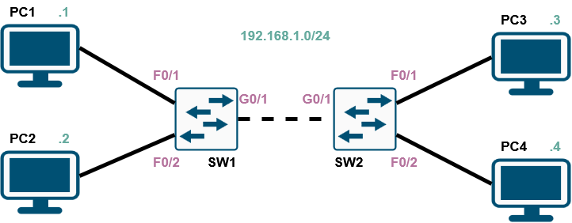
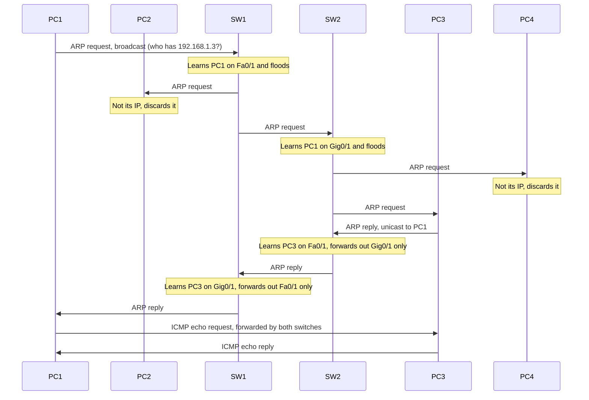

<div align="center">
<a id="readme-top"></a>

# 💻 Day 006 — Ethernet LAN Switching, Part 2

**Watching ARP and MAC learning across two switches, then reading and clearing the MAC address tables**

[](https://github.com/migyuelito/100-days-of-networking)


| 📅 Date | ⏱️ Time spent | 📚 Source | 🛠️ Work type |
|---|---|---|---|
| 2026-11-14 | 13 min | Jeremy's IT Lab, Free CCNA<br>Day 6 (Ethernet LAN Switching pt. 2)<br>Day 6 Lab (Analyzing Ethernet Switching)<br>▶️ [Playlist](https://www.youtube.com/playlist?list=PLxbwE86jKRgMpuZuLBivzlM8s2Dk5lXBQ) | Guided |

</div>

<!-- Aim for 10 minutes of writing. Copy this file to days/day-NNN/README.md. -->

> 🎯 **Goal:** Learn how switches learn Layer 2 (MAC) addresses, and how ARP gives devices the destination MAC address they need.

## 📋 What I Did

- [x] **Guided:** Followed the Day 6 lab instructions in Packet Tracer to test pings and watch the switches dynamically learn MAC addresses.

## 🗺️ Topology

<p align="center">
  
</p>

No default gateways; there's no router in this design.

| Host | Address | Mask | Connects to |
|:--|:--|:--|:--|
| PC1 | 192.168.1.1 | 255.255.255.0 | SW1 F0/1 |
| PC2 | 192.168.1.2 | 255.255.255.0 | SW1 F0/2 |
| PC3 | 192.168.1.3 | 255.255.255.0 | SW2 F0/1 |
| PC4 | 192.168.1.4 | 255.255.255.0 | SW2 F0/2 |

SW1 G0/1 connects to SW2 G0/1.

## ✅ Lab Tasks

> **Starting state:** Both switches have an empty MAC address table, and all PCs have an empty ARP table.

- [x] [**Task 1**](#task-1--predict-the-first-ping) — If PC1 pings PC3, what messages will be sent over the network, and which devices will receive them?
- [x] [**Task 2**](#task-2--verify-in-simulation-mode) — Send the ping and use Packet Tracer's simulation mode to verify your answer
- [x] [**Task 3**](#task-3--fill-the-mac-tables) — Use pings to generate network traffic and allow the switches to learn the MAC addresses of all PCs
- [x] [**Task 4**](#task-4--identify-each-pcs-mac-address) — Use `show` commands on the switches to identify the MAC address of each PC
- [x] [**Task 5**](#task-5--clear-the-mac-tables) — Clear the dynamic MAC addresses from the MAC address table of each switch

## 🔮 Part 1 — Predict and Verify

### Task 1 — Predict the first ping

> If PC1 pings PC3, what messages will be sent over the network, and which devices will receive them?

💡 **My solution:** Since PC1 doesn't know the destination MAC for PC3, it will send an ARP Request with the destination of the IP address. This ARP Request will broadcast to every device connected to SW1 and SW2, other than PC1 for SW1 and SW1 for SW2.

### Task 2 — Verify in simulation mode

> Send the ping and use Packet Tracer's simulation mode to verify your answer.

The full exchange, step by step, is in [Key Takeaways](#-key-takeaways).

## 🗂️ Part 2 — Fill the MAC Tables

### Task 3 — Fill the MAC tables

> Use pings to generate network traffic and allow the switches to learn the MAC addresses of all PCs on the network.

```
C:\> ping 192.168.1.4                ← from each PC's Command Prompt, ping the others
```

### Task 4 — Identify each PC's MAC address

> Use `show` commands on the switches to identify the MAC address of each PC.

```
SW1# show mac-address-table
SW2# show mac-address-table
```

Matching each switch port to the topology gives every PC's MAC address:

| PC | MAC address | Learned on SW1 | Learned on SW2 |
|:--|:--|:--:|:--:|
| PC1 | `00d0.d3ad.9cab` | Fa0/1 | Gig0/1 |
| PC2 | `0060.5c56.14d3` | Fa0/2 | Gig0/1 |
| PC3 | `0004.9a6e.d870` | Gig0/1 | Fa0/1 |
| PC4 | `0001.647b.3119` | Gig0/1 | Fa0/2 |

SW1's first check listed only three addresses. PC2's (`0060.5c56.14d3`) appeared once PC2 sent traffic, because a switch only learns a MAC address when a frame arrives *from* it.

📄 **Evidence:** [SW1 CLI output](evidence/01-sw1-mac-address-table.txt) · [SW2 CLI output](evidence/02-sw2-mac-address-table.txt)

## 🧹 Part 3 — Clear the MAC Tables

### Task 5 — Clear the MAC tables

> Clear the dynamic MAC addresses from the MAC address table of each switch.

```
SW1# clear mac-address-table dynamic
SW2# clear mac-address-table dynamic
```

Both switches' `show mac-address-table` came back empty afterward.

📄 **Evidence:** [SW1 CLI output](evidence/01-sw1-mac-address-table.txt) · [SW2 CLI output](evidence/02-sw2-mac-address-table.txt)

> [!NOTE]
> Packet Tracer only clears the whole table. Real IOS can also clear just one address or one interface, but Packet Tracer doesn't support those options.

## 🧪 Tests

<!-- Start each Actual with ✅ (matched) or ❌ (didn't match) so results scan at a glance. -->

| Test | Expected | Actual | Evidence |
|:--|:--|:--|:--|
| T1 · First ping, PC1 → PC3, with empty tables | PC1 broadcasts an ARP request; PC2, PC3, and PC4 all receive it | {{What simulation mode showed}} | — |
| T2 · MAC tables after pinging between all PCs | Each switch lists all four PCs: its own two on Fa0/1 and Fa0/2, the other switch's two on Gig0/1 | ✅ SW1: PC1 Fa0/1, PC2 Fa0/2, PC3 and PC4 Gig0/1. SW2: PC3 Fa0/1, PC4 Fa0/2, PC1 and PC2 Gig0/1 | [01](evidence/01-sw1-mac-address-table.txt) · [02](evidence/02-sw2-mac-address-table.txt) |
| T3 · Clear both MAC tables | Both tables are empty | ✅ Both tables empty | [01](evidence/01-sw1-mac-address-table.txt) · [02](evidence/02-sw2-mac-address-table.txt) |

## 📁 Evidence

| # | File | What it shows |
|:--:|:--|:--|
| 01 | [01-sw1-mac-address-table.txt](evidence/01-sw1-mac-address-table.txt) | SW1's MAC table filling up (three entries, then four), then cleared |
| 02 | [02-sw2-mac-address-table.txt](evidence/02-sw2-mac-address-table.txt) | SW2's MAC table with all four PCs, then cleared |

## 🧠 Key Takeaways

### The first ping, step by step



### ARP request vs. reply

| | ARP request | ARP reply |
|:--|:--|:--|
| **Sent as** | Broadcast, to `FFFF.FFFF.FFFF` | Unicast, to the requester's MAC |
| **Says** | "Who has 192.168.1.3? Tell 192.168.1.1" | "192.168.1.3 is at PC3's MAC" |
| **Reaches** | Every device in the LAN (PC2, PC3, PC4) | Only PC1 |

- **Switches learn from source MACs:** each switch maps the sender's MAC to the port the frame came in on.
- **One port, many MACs:** each switch learned two PCs on Gig0/1, its link to the other switch.
- **Entries don't last forever:** dynamic MAC entries age out after 5 minutes without traffic, and `clear mac-address-table dynamic` removes them on demand.

## 📚 Command Cheat Sheet

| Command | Where | What it does |
|:--|:--|:--|
| `ping 192.168.1.3` | PC → Command Prompt | Sends ICMP echo requests (ARP runs first if needed) |
| `arp -a` | PC → Command Prompt | Shows the PC's ARP table (IP → MAC) |
| `show mac-address-table` | Switch, privileged EXEC | Lists learned MACs with their VLAN, type, and port |
| `clear mac-address-table dynamic` | Switch, privileged EXEC | Removes all dynamically learned MACs |

<sub>Packet Tracer also accepts the newer spelling without the hyphen: `show mac address-table` and `clear mac address-table dynamic`.</sub>

## 📝 Synopsis

Day 6 of Jeremy's IT Lab labs.

Getting more hands-on with the CLI. A lot of the information I already knew.

---

<div align="center">

⬅️ **Previous:** [Day 005 · Ethernet LAN Switching, Part 1](https://github.com/migyuelito/100-days-of-networking/blob/main/days/day-005/README.md) &nbsp;&nbsp;•&nbsp;&nbsp; **Next:** [Day 007 · IPv4 Addressing, Part 1](https://github.com/migyuelito/100-days-of-networking/blob/main/days/day-007/README.md) ➡️

**[⬆ Back to top](#readme-top)**

</div>
