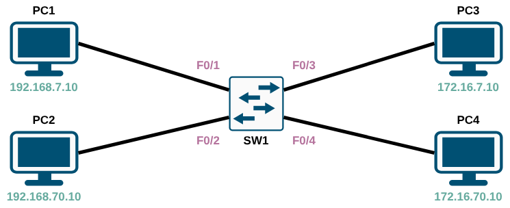

<div align="center">
<a id="readme-top"></a>

# 💻 Day 007 — IPv4 Addressing, Part 1

**Same switch, different networks: finding where the netmask draws the line**

[](https://github.com/migyuelito/100-days-of-networking)


| 📅 Date | ⏱️ Time spent | 📚 Source | 🛠️ Work type |
|---|---|---|---|
| 2026-11-15 | {{TIME}} | Jeremy's IT Lab, Free CCNA<br>Day 7 (IPv4 Addressing pt. 1)<br>Custom lab written with Claude (the course has no Day 7 lab)<br>▶️ [Playlist](https://www.youtube.com/playlist?list=PLxbwE86jKRgMpuZuLBivzlM8s2Dk5lXBQ) | Guided |

</div>

<!-- Aim for 10 minutes of writing. Copy this file to days/day-NNN/README.md. -->
<!-- Pre-drafted lab: replace each double-curly-brace placeholder with what you did and saw, tick the tasks you finish, and delete anything you skip. -->

> 🎯 **Goal:** Find the network and host portions of IPv4 addresses by hand, then prove in Packet Tracer which PCs on one switch can reach each other, and why.

## 📋 What I Did

- [ ] **Guided:** Worked out the address plan on paper, built the custom Day 7 lab in Packet Tracer, and tested which PCs could reach each other.

## 🗺️ Topology

<p align="center">
  
</p>

No default gateways; there's no router in this design. Each PC uses the default mask for its address class, so fill in the Mask column after Task 2.

| Host | Address | Mask | Connects to |
|:--|:--|:--|:--|
| PC1 | 192.168.7.10 | {{ }} | SW1 F0/1 |
| PC2 | 192.168.70.10 | {{ }} | SW1 F0/2 |
| PC3 | 172.16.7.10 | {{ }} | SW1 F0/3 |
| PC4 | 172.16.70.10 | {{ }} | SW1 F0/4 |

> [!TIP]
> **The scenario:** A coworker cabled four PCs to one switch and addressed them from a sticky note. PC1 and PC2 differ only in the third octet, and so do PC3 and PC4. Their reasoning: same switch, same pattern, same result. Check that claim on paper first, then in Packet Tracer.

## ✅ Lab Tasks

> **Rules:** Part 1 is pen and paper. Finish it before you open Packet Tracer, and skip the subnet calculators.

- [ ] [**Task 1**](#task-1--classify-the-candidate-addresses) — Classify the candidate addresses
- [ ] [**Task 2**](#task-2--work-out-each-pcs-network) — Work out each PC's network
- [ ] [**Task 3**](#task-3--prove-it-in-binary) — Prove it in binary
- [ ] [**Task 4**](#task-4--build-and-address-the-lan) — Build and address the LAN
- [ ] [**Task 5**](#task-5--predict-then-ping-every-pair) — Predict, then ping every pair
- [ ] [**Task 6**](#task-6--trace-a-ping-in-simulation-mode) — Trace a ping in Simulation mode
- [ ] [**Task 7**](#task-7--fix-it-without-a-router) — Fix it without a router
- [ ] [**Task 8**](#task-8--challenge-when-two-pcs-disagree) — Challenge: when two PCs disagree
- [ ] [**Task 9**](#task-9--bonus-the-loopback-and-whats-next) — Bonus: the loopback, and what's next

## 🧮 Part 1 — Plan on Paper

### Task 1 — Classify the candidate addresses

> The sticky note listed more candidates than there are PCs.
> - Identify each address's class. Assume it uses its class's default mask.
> - Decide whether it could be assigned to a PC.
> - If it can't, say why.

| Address | Class | Assignable to a PC? | Why or why not |
|:--|:--:|:--:|:--|
| 172.31.0.255 | {{ }} | {{ }} | {{ }} |
| 127.0.0.1 | {{ }} | {{ }} | {{ }} |
| 199.99.10.255 | {{ }} | {{ }} | {{ }} |
| 10.255.0.0 | {{ }} | {{ }} | {{ }} |
| 224.0.0.5 | {{ }} | {{ }} | {{ }} |
| 191.255.0.0 | {{ }} | {{ }} | {{ }} |
| 126.255.255.254 | {{ }} | {{ }} | {{ }} |
| 240.1.2.3 | {{ }} | {{ }} | {{ }} |

> [!NOTE]
> **What rule did you use to decide whether an address was a network address or a broadcast address?**
>
> ➜ {{your answer}}

### Task 2 — Work out each PC's network

> - For each PC's address, work out its class, default mask, prefix length, network address, and broadcast address.
> - Copy the masks into the topology table.

| Host | Address | Class | Default mask | Prefix | Network address | Broadcast address |
|:--|:--|:--:|:--|:--:|:--|:--|
| PC1 | 192.168.7.10 | {{ }} | {{ }} | {{ }} | {{ }} | {{ }} |
| PC2 | 192.168.70.10 | {{ }} | {{ }} | {{ }} | {{ }} | {{ }} |
| PC3 | 172.16.7.10 | {{ }} | {{ }} | {{ }} | {{ }} | {{ }} |
| PC4 | 172.16.70.10 | {{ }} | {{ }} | {{ }} | {{ }} | {{ }} |

> [!NOTE]
> **Which PCs share a network?**
>
> ➜ {{your answer}}
>
> **The coworker wants to add a fifth PC to PC3's network. What are the lowest and highest addresses it could use?**
>
> ➜ {{your answer}}

### Task 3 — Prove it in binary

> - Convert each PC's address to binary, octet by octet.
> - Replace the dot where the network portion ends with a `|`.

```
        Octet 1    Octet 2    Octet 3    Octet 4
PC1     ________ . ________ . ________ . ________
PC2     ________ . ________ . ________ . ________
PC3     ________ . ________ . ________ . ________
PC4     ________ . ________ . ________ . ________
```

> [!NOTE]
> **PC2 differs from PC1 in the same octet, by the same amount, as PC4 differs from PC3. For each pair, does that difference fall in the network portion or the host portion? What does that mean for the pair?**
>
> ➜ {{your answer}}
>
> **How many host bits does each PC's network have?**
>
> ➜ {{your answer}}

## 🔌 Part 2 — Build and Test

### Task 4 — Build and address the LAN

> - Recreate the topology in Packet Tracer: one 2960 switch and four PCs, cabled to the ports shown.
> - Set SW1's hostname in its configuration, not just its name on the canvas, and save the configuration.
> - Address each PC from your plan. Leave the default gateway blank.
> - Verify each PC's addressing before you move on.

💡 **My solution:** {{ }}

> [!NOTE]
> **Packet Tracer fills in a mask for you when you enter an address. Did it match your Task 2 answers? What rule is it following?**
>
> ➜ {{your answer}}

### Task 5 — Predict, then ping every pair

> - Fill in the Prediction column using only your Part 1 work.
> - Then ping every pair (one direction is enough) and record the result. A pair counts as ✅ if any reply comes back.
> - Save PC1's and PC3's ping output as evidence (see [Evidence](#-evidence)).

| Pair | Prediction | Result |
|:--|:--:|:--:|
| PC1 ↔ PC2 | {{ }} | {{ }} |
| PC1 ↔ PC3 | {{ }} | {{ }} |
| PC1 ↔ PC4 | {{ }} | {{ }} |
| PC2 ↔ PC3 | {{ }} | {{ }} |
| PC2 ↔ PC4 | {{ }} | {{ }} |
| PC3 ↔ PC4 | {{ }} | {{ }} |

> [!NOTE]
> **Did any result surprise you? Which part of your Part 1 work explains it?**
>
> ➜ {{your answer}}

### Task 6 — Trace a ping in Simulation mode

> - In Simulation mode, send one ping between a pair that failed in Task 5, and one between a pair that worked.
> - Step through both.
> - Screenshot where the failed ping stops, including the reason Packet Tracer gives.

> [!NOTE]
> **For the failed pair, how far did the ping get? Did anything leave the sending PC?**
>
> ➜ {{your answer}}
>
> **What reason does Packet Tracer give for the sending PC's decision?**
>
> ➜ {{your answer}}
>
> **Both PCs are plugged into the same switch. Why didn't that help?**
>
> ➜ {{your answer}}

## 🔧 Part 3 — Move the Line

### Task 7 — Fix it without a router

> - Make PC1 ↔ PC2 and PC3 ↔ PC4 both work.
> - Don't change any IP address, and don't add, remove, or recable any device.

💡 **My solution:** {{ }}

> [!NOTE]
> **Which pair needed a change? What did you change, and which network is that pair in now?**
>
> ➜ {{your answer}}
>
> **Stretch: find a second setting that also works. What do the working settings have in common?**
>
> ➜ {{your answer}}

### Task 8 — Challenge: when two PCs disagree

> - Take the pair you fixed in Task 7 and put just one of its PCs back the way it was in Task 4.
> - Before testing, work out which network each of the two PCs thinks the other one is in.
> - Then, in Simulation mode, send a ping in each direction and step through both.

> [!NOTE]
> **Which network does each PC think the other one is in?**
>
> ➜ {{your answer}}
>
> **How far did each direction get? If a ping stopped, name the device where it stopped and the reason Packet Tracer gives.**
>
> ➜ {{your answer}}
>
> **Why can a mismatch like this be harder to troubleshoot than a plain wrong address?**
>
> ➜ {{your answer}}

## 🔭 Bonus — Looking Ahead

### Task 9 — Bonus: the loopback, and what's next

> - From any PC, ping the loopback address.
> - Then think about how PC1 could reach PC3 while both keep their addresses.

> [!NOTE]
> **What does a reply from the loopback address prove, and what doesn't it prove?**
>
> ➜ {{your answer}}
>
> **What kind of device could connect PC1's network to PC3's, and what would it need in each network?**
>
> ➜ {{your answer}}

## 🧪 Tests

<!-- Write each Expected before you run the test. Start each Actual with ✅ (matched) or ❌ (didn't match). -->

| Test | Expected | Actual | Evidence |
|:--|:--|:--|:--|
| T1 · PC1 pings PC2 | {{your prediction}} | {{ }} | [01](evidence/01-pc1-pings.txt) |
| T2 · PC3 pings PC4 | {{your prediction}} | {{ }} | [02](evidence/02-pc3-pings.txt) |
| T3 · PC1 pings PC3 | {{your prediction}} | {{ }} | [01](evidence/01-pc1-pings.txt) |
| T4 · Where a failed ping stops | {{your prediction}} | {{ }} | [03](evidence/03-failed-ping-simulation.png) |
| T5 · Both pairs after Task 7 | {{your prediction}} | {{ }} | [04](evidence/04-after-task-7.txt) |
| T6 · Challenge: each direction after Task 8 | {{your prediction}} | {{ }} | [05](evidence/05-mismatch-simulation.png) |

## 📁 Evidence

| # | File | What it shows |
|:--:|:--|:--|
| 01 | [01-pc1-pings.txt](evidence/01-pc1-pings.txt) | PC1 pinging PC2, PC3, and PC4 |
| 02 | [02-pc3-pings.txt](evidence/02-pc3-pings.txt) | PC3 pinging PC1, PC2, and PC4 |
| 03 | [03-failed-ping-simulation.png](evidence/03-failed-ping-simulation.png) | Where a failed ping stopped, and Packet Tracer's reason |
| 04 | [04-after-task-7.txt](evidence/04-after-task-7.txt) | PC1 ↔ PC2 and PC3 ↔ PC4 pings after Task 7 |
| 05 | [05-mismatch-simulation.png](evidence/05-mismatch-simulation.png) | Challenge: how far each direction got after Task 8 |

## 🧠 Key Takeaways

<!-- Write these from memory after the lab, then check them against the answer key. -->

{{The address classes from memory: first-octet range, default mask, and prefix for each}}

{{How a PC decides whether another address is in its own network}}

{{What decides whether two PCs on the same switch can talk without a router}}

## 📚 Command Cheat Sheet

<!-- Add each command or Packet Tracer tool you used, after you've used it. -->

| Command or tool | Where | What it does |
|:--|:--|:--|
| {{ }} | {{ }} | {{ }} |

## 📝 Synopsis

{{How it went: what clicked, what didn't, and what you'd do differently}}

---

<div align="center">

⬅️ **Previous:** [Day 006 · Ethernet LAN Switching, Part 2](https://github.com/migyuelito/100-days-of-networking/blob/main/days/day-006/README.md) &nbsp;&nbsp;•&nbsp;&nbsp; **Next:** [Day 008 · IPv4 Addressing, Part 2](https://github.com/migyuelito/100-days-of-networking/blob/main/days/day-008/README.md) ➡️

**[⬆ Back to top](#readme-top)**

</div>
