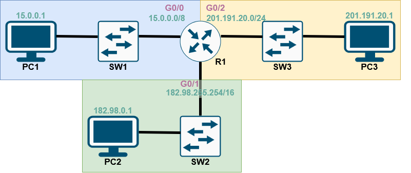
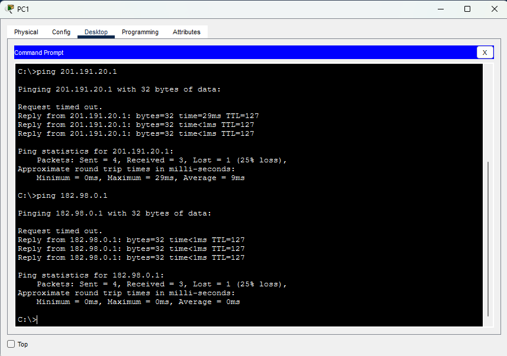

<div align="center">
<a id="readme-top"></a>

# 💻 Day 008 — IPv4 Addressing, Part 2

**Addressing R1's interfaces to connect three networks, then pinging across them**

[](https://github.com/migyuelito/100-days-of-networking)


| 📅 Date | ⏱️ Time spent | 📚 Source | 🛠️ Work type |
|---|---|---|---|
| 2026-11-16 | 7 min | Jeremy's IT Lab, Free CCNA<br>Day 8 (IPv4 Addressing pt. 2)<br>Day 8 Lab (Configuring IP Addresses)<br>▶️ [Playlist](https://www.youtube.com/playlist?list=PLxbwE86jKRgMpuZuLBivzlM8s2Dk5lXBQ) | Guided |

</div>

<!-- Aim for 10 minutes of writing. Copy this file to days/day-NNN/README.md. -->

> 🎯 **Goal:** Set up the network by giving R1's interfaces the right IP addresses and subnet masks, so the router can connect three networks.

## 📋 What I Did

- [x] **Guided:** Worked out the IP addressing for the Day 8 lab in Packet Tracer, configured R1's interfaces, and tested traffic between the PCs.

## 🗺️ Topology

<p align="center">
  
</p>

R1 connects three networks, one per interface. The lab file already had each PC's default gateway filled in: R1's address in that PC's network.

**R1**

| Interface | Address | Mask | Description | Connects to |
|:--|:--|:--|:--|:--|
| G0/0 | 15.255.255.254 | 255.0.0.0 | `#PC1 Net Traffic` | SW1 (PC1's LAN) |
| G0/1 | 182.98.255.254 | 255.255.0.0 | `#PC2 Net Traffic` | SW2 (PC2's LAN) |
| G0/2 | 201.191.20.254 | 255.255.255.0 | `#PC3 Net Traffic` | SW3 (PC3's LAN) |

**Hosts**

| Host | Address | Mask | Default gateway | Connects to |
|:--|:--|:--|:--|:--|
| PC1 | 15.0.0.1 | 255.0.0.0 | 15.255.255.254 | SW1 |
| PC2 | 182.98.0.1 | 255.255.0.0 | 182.98.255.254 | SW2 |
| PC3 | 201.191.20.1 | 255.255.255.0 | 201.191.20.254 | SW3 |

## ✅ Lab Tasks

> **Starting state:** R1 has its default configuration, with the hostname `Router` and no interface addresses. The PCs' default gateways are already set.

- [x] [**Task 1**](#task-1--configure-r1s-hostname) — Configure R1's hostname
- [x] [**Task 2**](#task-2--view-r1s-interfaces) — Use a `show` command to view a list of R1's interfaces, their IP addresses, status, etc.
- [x] [**Task 3**](#task-3--address-enable-and-describe-the-interfaces) — Configure the appropriate IP addresses on R1's interfaces, and enable the interfaces. Configure appropriate interface descriptions
- [x] [**Task 4**](#task-4--verify-r1s-interfaces) — Use a `show` command to verify R1's interfaces again
- [x] [**Task 5**](#task-5--check-and-save-the-running-config) — View the running config to confirm the configuration changes, then save the config
- [x] [**Task 6**](#task-6--address-the-pcs) — Configure the IP addresses of PC1, PC2, and PC3
- [x] [**Task 7**](#task-7--ping-across-r1) — Ping from PC1 to PC2 and PC3 to test connectivity

## 🏷️ Part 1 — Hostname and First Look

### Task 1 — Configure R1's hostname

> Configure R1's hostname.

💡 **My solution:** Moved from user EXEC to global config mode, then set the hostname.

```
Router> en
Router# conf t
Router(config)# hostname R1
R1(config)#                         ← the prompt picks up the new name right away
```

### Task 2 — View R1's interfaces

> Use a `show` command to view a list of R1's interfaces, their IP addresses, status, etc.

💡 **My solution:** `show ip interface brief`, run from global config mode with `do` in front.

```
R1(config)# do show ip int br
Interface              IP-Address      OK? Method Status                Protocol
GigabitEthernet0/0     unassigned      YES unset  administratively down down
GigabitEthernet0/1     unassigned      YES unset  administratively down down
GigabitEthernet0/2     unassigned      YES unset  administratively down down
Vlan1                  unassigned      YES unset  administratively down down
```

All three GigabitEthernet interfaces start with no address and **administratively down**: a router's interfaces stay shut down until you enable them.

📄 **Evidence:** [R1 CLI output](evidence/R1-CLI-Commands.txt)

> [!TIP]
> `show` commands don't run in global config mode on their own. The first try, `show ip int br`, came back with `% Invalid input detected`. Putting `do` in front runs it without leaving config mode.

## 🔌 Part 2 — Address the Interfaces

### Task 3 — Address, enable, and describe the interfaces

> Configure the appropriate IP addresses on R1's interfaces, and enable the interfaces. Configure appropriate interface descriptions.

💡 **My solution:** For each interface: an IP address and mask (the last usable address in its network), a description naming the PC it serves, and `no shutdown`.

```
R1(config)# int g0/0
R1(config-if)# ip add 15.255.255.254 255.0.0.0
R1(config-if)# description ?        ← context help shows the syntax
  LINE  Up to 240 characters describing this interface
R1(config-if)# description #PC1 Net Traffic
R1(config-if)# no shutdown
%LINK-5-CHANGED: Interface GigabitEthernet0/0, changed state to up
%LINEPROTO-5-UPDOWN: Line protocol on Interface GigabitEthernet0/0, changed state to up

R1(config-if)# int g0/1
R1(config-if)# ip add 182.98.255.254 255.255.0.0
R1(config-if)# desc #PC2 Net Traffic
R1(config-if)# no shut
%LINK-5-CHANGED: Interface GigabitEthernet0/1, changed state to up
%LINEPROTO-5-UPDOWN: Line protocol on Interface GigabitEthernet0/1, changed state to up

R1(config-if)# int g0/2
R1(config-if)# ip add 201.191.20.254 255.255.255.0
R1(config-if)# description #PC3 Net Traffic
R1(config-if)# no shutdown
%LINK-5-CHANGED: Interface GigabitEthernet0/2, changed state to up
%LINEPROTO-5-UPDOWN: Line protocol on Interface GigabitEthernet0/2, changed state to up
```

### Task 4 — Verify R1's interfaces

> Use a `show` command to verify R1's interfaces again.

Before ➜ after: every interface now has its address, and Status and Protocol both read **up**. `Method` changed from `unset` to `manual` because the addresses were typed in by hand.

```diff
  R1(config)# do show ip int br
  Interface              IP-Address      OK? Method Status                Protocol
- GigabitEthernet0/0     unassigned      YES unset  administratively down down
- GigabitEthernet0/1     unassigned      YES unset  administratively down down
- GigabitEthernet0/2     unassigned      YES unset  administratively down down
+ GigabitEthernet0/0     15.255.255.254  YES manual up                    up
+ GigabitEthernet0/1     182.98.255.254  YES manual up                    up
+ GigabitEthernet0/2     201.191.20.254  YES manual up                    up
  Vlan1                  unassigned      YES unset  administratively down down
```

## 💾 Part 3 — Confirm and Save

### Task 5 — Check and save the running config

> View the running config to confirm the configuration changes, then save the config.

The hostname, addresses, and descriptions are all in the running config, and the save returned `[OK]`. Trimmed here; the full output is in the evidence.

```
R1(config)# do show run
...
hostname R1
...
interface GigabitEthernet0/0
 description #PC1 Net Traffic
 ip address 15.255.255.254 255.0.0.0
 duplex auto
 speed auto
!
interface GigabitEthernet0/1
 description #PC2 Net Traffic
 ip address 182.98.255.254 255.255.0.0
 duplex auto
 speed auto
!
interface GigabitEthernet0/2
 description #PC3 Net Traffic
 ip address 201.191.20.254 255.255.255.0
 duplex auto
 speed auto
!
interface Vlan1
 no ip address
 shutdown                           ← the only interface still shut down
...
R1(config)# do write mem
Building configuration...
[OK]
```

📄 **Evidence:** [R1 CLI output](evidence/R1-CLI-Commands.txt)

> [!NOTE]
> `no shutdown` never appears in the running config. An enabled interface simply has no `shutdown` line, which is how you can tell G0/0–G0/2 are on and Vlan1 is still off.

## 💻 Part 4 — Address the PCs and Test

### Task 6 — Address the PCs

> Configure the IP addresses of PC1, PC2, and PC3.

💡 **My solution:** The lab had the gateway addresses already filled in, so I followed the IP addressing plan and manually configured each PC's IPv4 address and subnet mask. Each PC got the first usable address in its network.

### Task 7 — Ping across R1

> Ping from PC1 to PC2 and PC3 to test connectivity.

<p align="center">
  
</p>

Both pings worked through R1, with 3 of 4 replies each. The first request each time timed out while R1 used ARP to find the destination PC's MAC address. Every reply shows **TTL=127**: one less than the 128 a PC starts with, because R1 forwarded it.

📄 **Evidence:** [PC1 ping screenshot](evidence/008-task-7.png)

## 🧪 Tests

<!-- Start each Actual with ✅ (matched) or ❌ (didn't match) so results scan at a glance. -->

| Test | Expected | Actual | Evidence |
|:--|:--|:--|:--|
| T1 · R1's interfaces, before | Unassigned, administratively down | ✅ All three unassigned, administratively down | [01](evidence/R1-CLI-Commands.txt) |
| T2 · R1's interfaces, after | Addressed and up/up | ✅ All three addressed and up/up | [01](evidence/R1-CLI-Commands.txt) |
| T3 · Save the config | `[OK]` | ✅ `[OK]` | [01](evidence/R1-CLI-Commands.txt) |
| T4 · PC1 pings PC3 | Replies through R1 | ✅ 3 of 4 replies, TTL=127 | [02](evidence/008-task-7.png) |
| T5 · PC1 pings PC2 | Replies through R1 | ✅ 3 of 4 replies, TTL=127 | [02](evidence/008-task-7.png) |

## 📁 Evidence

| # | File | What it shows |
|:--:|:--|:--|
| 01 | [R1-CLI-Commands.txt](evidence/R1-CLI-Commands.txt) | R1's whole CLI session, from hostname to save |
| 02 | [008-task-7.png](evidence/008-task-7.png) | PC1 pinging PC3 and PC2 through R1 |

## 🧠 Key Takeaways

### First and last usable addresses

Each PC took the first usable address in its network, and R1 took the last:

| Network | Class | Usable hosts | First usable (PC) | Last usable (R1) | Broadcast |
|:--|:--:|--:|:--|:--|:--|
| 15.0.0.0/8 | A | 16,777,214 | 15.0.0.1 | 15.255.255.254 | 15.255.255.255 |
| 182.98.0.0/16 | B | 65,534 | 182.98.0.1 | 182.98.255.254 | 182.98.255.255 |
| 201.191.20.0/24 | C | 254 | 201.191.20.1 | 201.191.20.254 | 201.191.20.255 |

**Usable hosts = 2<sup>host bits</sup> − 2.** The network address and the broadcast address can't go on a host, so a /24 with 8 host bits gives 2<sup>8</sup> − 2 = 254.

### Reading `show ip interface brief`

| Status | Protocol | What it means |
|:--|:--|:--|
| administratively down | down | Shut down with `shutdown`, the default for a router interface |
| up | up | Enabled, cabled, and working |

- **Status is Layer 1, Protocol is Layer 2:** the `%LINK-5-CHANGED` and `%LINEPROTO-5-UPDOWN` messages after `no shutdown` are those same two layers coming up.
- **`do` runs EXEC commands from config mode:** without it, `show` returns `% Invalid input detected`.
- **TTL=127 means one router hop:** the replies left the PCs at TTL 128, and R1 subtracted 1.

### 📌 Remember next time

- `ipconfig` — check it against the addressing plan before trusting a ping
- Simulation mode — shows where a packet stops and why

## 📚 Command Cheat Sheet

| Command | Where | What it does |
|:--|:--|:--|
| `enable` | User EXEC | Enter privileged EXEC mode |
| `configure terminal` | Privileged EXEC | Enter global config mode |
| `hostname <name>` | Global config | Set the device's hostname |
| `show ip interface brief` | Privileged EXEC | List each interface's address, status, and protocol |
| `do <command>` | Any config mode | Run an EXEC command, like `show`, from config mode |
| `interface <name>` | Global config | Enter interface config mode |
| `ip address <ip> <mask>` | Interface config | Set the interface's IPv4 address and mask |
| `description <text>` | Interface config | Label the interface |
| `no shutdown` | Interface config | Enable the interface |
| `show running-config` | Privileged EXEC | Display the current configuration |
| `write memory` | Privileged EXEC | Save the running config to the startup config |
| `ping <address>` | PC → Command Prompt | Test reachability to another host |

<sub>IOS accepts any unambiguous abbreviation. The evidence uses the short forms: `en`, `conf t`, `show ip int br`, `int g0/0`, `ip add`, `desc`, `no shut`, `show run`, and `write mem`.</sub>

## 📝 Synopsis

***Day 8 of Jeremy's IT Lab labs.***

IPv4 Addressing is probably my favorite part of the early learnings of Jeremy's IT Lab. This was a simple lab to complete from memory.

---

<div align="center">

⬅️ **Previous:** [Day 007 · IPv4 Addressing, Part 1](https://github.com/migyuelito/100-days-of-networking/blob/main/days/day-007/README.md) &nbsp;&nbsp;•&nbsp;&nbsp; **Next:** Day 009 · Switch Interfaces ➡️

**[⬆ Back to top](#readme-top)**

</div>
