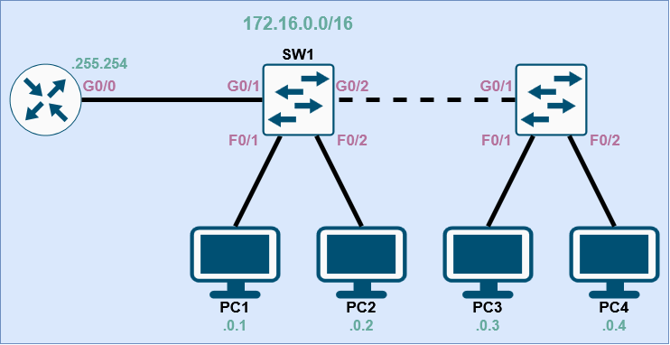

<div align="center">
<a id="readme-top"></a>

# 💻 Day 009 — Switch Interfaces

**Hard-setting speed and duplex, labeling interfaces, and shutting down unused ports**

[](https://github.com/migyuelito/100-days-of-networking)


| 📅 Date | ⏱️ Time spent | 📚 Source | 🛠️ Work type |
|---|---|---|---|
| 2026-11-21 | 15 min | Jeremy's IT Lab, Free CCNA<br>Day 9 (Switch Interfaces)<br>Day 9 Lab (Configuring Interfaces)<br>▶️ [Playlist](https://www.youtube.com/playlist?list=PLxbwE86jKRgMpuZuLBivzlM8s2Dk5lXBQ) | Guided |

</div>

<!-- Aim for 10 minutes of writing. Copy this file to days/day-NNN/README.md. -->

> 🎯 **Goal:** Configure R1, SW1, and SW2's interfaces: addresses, fixed speed and duplex on the links between network devices, descriptions, and every unused port shut down.

## 📋 What I Did

- [x] **Guided:** Followed the Day 9 lab in Packet Tracer: hostnames, IP addresses, speed and duplex, interface descriptions, and shutting down unused ports.

## 🗺️ Topology

<p align="center">
  
</p>

One network, 172.16.0.0/16, spread across two switches.

| Device | Address | Mask | Connects to |
|:--|:--|:--|:--|
| R1 (G0/0) | 172.16.255.254 | 255.255.0.0 | SW1 G0/1 |
| PC1 | 172.16.0.1 | 255.255.0.0 | SW1 F0/1 |
| PC2 | 172.16.0.2 | 255.255.0.0 | SW1 F0/2 |
| PC3 | 172.16.0.3 | 255.255.0.0 | SW2 F0/1 |
| PC4 | 172.16.0.4 | 255.255.0.0 | SW2 F0/2 |

SW1 G0/2 connects to SW2 G0/1.

## ✅ Lab Tasks

> **Starting state:** All three devices have their default configuration. Switch ports are enabled; router ports are shut down.

- [x] [**Task 1**](#task-1--configure-the-device-hostnames) — Configure the hostname of R1, SW1, and SW2
- [x] [**Task 2**](#task-2--configure-ip-addresses) — Configure the appropriate IP addresses on R1, PC1, PC2, PC3, PC4
- [x] [**Task 3**](#task-3--set-speed-and-duplex) — Manually configure the speed and duplex on interfaces connected to other networking devices (not end hosts)
- [x] [**Task 4**](#task-4--configure-descriptions) — Configure appropriate descriptions on each interface
- [x] [**Task 5**](#task-5--disable-non-connected-interfaces) — Disable interfaces which are not connected to other devices

## 🏷️ Part 1 — Names and Addresses

### Task 1 — Configure the device hostnames

> Configure the hostname of R1, SW1, and SW2.

💡 **My solution:** The same three steps on each device.

```
Router> en
Router# conf t
Router(config)# hostname R1
R1(config)#

Switch> en
Switch# conf t
Switch(config)# hostname SW1
SW1(config)#

Switch> en
Switch# conf t
Switch(config)# hostname SW2
SW2(config)#
```

### Task 2 — Configure IP addresses

> Configure the appropriate IP addresses on R1, PC1, PC2, PC3, PC4.

💡 **My solution:** R1's G0/0 got the last usable address in 172.16.0.0/16, and each PC got its address and mask from the table above.

```
R1# conf t
R1(config)# int g0/0
R1(config-if)# ip add 172.16.255.254 255.255.0.0
R1(config-if)# no shutdown
%LINK-5-CHANGED: Interface GigabitEthernet0/0, changed state to up
%LINEPROTO-5-UPDOWN: Line protocol on Interface GigabitEthernet0/0, changed state to up
```

## 🔧 Part 2 — Speed, Duplex, and Descriptions

### Task 3 — Set speed and duplex

> Manually configure the speed and duplex on interfaces connected to other networking devices (not end hosts).

💡 **My solution:** 1000 Mbps, full duplex, on both ends of each link between network devices. I also set the PC-facing ports: 100/full on SW1 and 100/half on SW2.

```
R1(config)# int g0/0
R1(config-if)# speed 1000
R1(config-if)# duplex full

SW1(config)# int range g0/1 - 2
SW1(config-if-range)# speed 1000
SW1(config-if-range)# duplex full
SW1(config-if-range)# int range f0/1 - 2
SW1(config-if-range)# speed 1000
                               ^
% Invalid input detected at '^' marker.
SW1(config-if-range)# speed 100
SW1(config-if-range)# duplex ?
  auto  Enable AUTO duplex configuration
  full  Force full duplex operation
  half  Force half-duplex operation
SW1(config-if-range)# duplex full

SW2(config)# int g0/1
SW2(config-if)# speed 1000
SW2(config-if)# duplex full
SW2(config-if)# int range f0/1 - 2
SW2(config-if-range)# speed 100
SW2(config-if-range)# duplex half
```

> [!TIP]
> `speed 1000` failed on F0/1–F0/2 because FastEthernet ports top out at 100 Mbps, so 1000 isn't an option there. `duplex ?` lists the choices before you commit to one.

> [!WARNING]
> F0/1 and F0/2 face PCs, and PCs default to auto. Hard-setting both speed and duplex turns autonegotiation off on those switch ports, so each PC senses 100 Mbps and falls back to half duplex. That matches SW2's `duplex half`, but not SW1's `duplex full`: a duplex mismatch on PC1's and PC2's links. Packet Tracer kept the links up; real hardware would show collisions and errors. It's a good reason to leave end-host ports on auto, as the lab does.

### Task 4 — Configure descriptions

> Configure appropriate descriptions on each interface.

💡 **My solution:** Each link between devices is labeled with what's on the other end. The unused ports get theirs in Task 5.

```
R1(config)# int g0/0
R1(config-if)# description ## To Switch 1 ##

SW1(config)# int g0/1
SW1(config-if)# desc ## To Router 1 ##
SW1(config-if)# int g0/2
SW1(config-if)# desc ## To Switch 2 ##

SW2(config)# int g0/1
SW2(config-if)# desc ## To Switch 1 ##
```

## 🔒 Part 3 — Shut Down Unused Ports

### Task 5 — Disable non-connected interfaces

> Disable interfaces which are not connected to other devices.

💡 **My solution:** Checked each device with `show ip interface brief`, then shut down and labeled the unused ports, using `interface range` for F0/3–F0/24.

**R1**

```
R1# sh ip int br
Interface              IP-Address      OK? Method Status                Protocol
GigabitEthernet0/0     172.16.255.254  YES manual up                    up
GigabitEthernet0/1     unassigned      YES unset  administratively down down
GigabitEthernet0/2     unassigned      YES unset  administratively down down
Vlan1                  unassigned      YES unset  administratively down down
```

> [!NOTE]
> Router 1 had already disabled interfaces.

**SW1**

```
SW1(config)# do show ip int br
Interface              IP-Address      OK? Method Status                Protocol
FastEthernet0/1        unassigned      YES manual up                    up
FastEthernet0/2        unassigned      YES manual up                    up
FastEthernet0/3        unassigned      YES manual down                  down
...                                                     ← F0/4 to F0/23 are the same
FastEthernet0/24       unassigned      YES manual down                  down
GigabitEthernet0/1     unassigned      YES manual up                    up
GigabitEthernet0/2     unassigned      YES manual up                    up
Vlan1                  unassigned      YES manual administratively down down
SW1(config)# int range f0/3 - 24
SW1(config-if-range)# shutdown
%LINK-5-CHANGED: Interface FastEthernet0/3, changed state to administratively down
...                                                     ← one message per port
%LINK-5-CHANGED: Interface FastEthernet0/24, changed state to administratively down
SW1(config-if-range)# desc ## Unused Port ##
```

📄 **Evidence:** [Full SW1 session](evidence/SW1-unused-ports.txt)

**SW2**

SW2 has one more unused port than SW1: G0/2, since SW2 is at the end of the chain.

```
SW2(config)# do show ip int br
Interface              IP-Address      OK? Method Status                Protocol
FastEthernet0/1        unassigned      YES manual up                    up
FastEthernet0/2        unassigned      YES manual up                    up
FastEthernet0/3        unassigned      YES manual down                  down
...                                                     ← F0/4 to F0/23 are the same
FastEthernet0/24       unassigned      YES manual down                  down
GigabitEthernet0/1     unassigned      YES manual up                    up
GigabitEthernet0/2     unassigned      YES manual down                  down
Vlan1                  unassigned      YES manual administratively down down
SW2(config)# int range f0/3 - 24
SW2(config-if-range)# shutdown
%LINK-5-CHANGED: Interface FastEthernet0/3, changed state to administratively down
...                                                     ← one message per port
%LINK-5-CHANGED: Interface FastEthernet0/24, changed state to administratively down
SW2(config-if-range)# desc ## Unused Port ##
SW2(config-if-range)# int g0/2
SW2(config-if)# shutdown
%LINK-5-CHANGED: Interface GigabitEthernet0/2, changed state to administratively down
SW2(config-if)# desc ## Unused Port ##
```

📄 **Evidence:** [Full SW2 session](evidence/SW2-unused-ports.txt)

## 🧪 Tests

<!-- Start each Actual with ✅ (matched) or ❌ (didn't match) so results scan at a glance. -->

| Test | Expected | Actual | Evidence |
|:--|:--|:--|:--|
| T1 · Hostnames | R1, SW1, and SW2 | ✅ All three set | [01](evidence/R1-running-config.txt) · [02](evidence/SW1-running-config.txt) · [03](evidence/SW2-running-config.txt) |
| T2 · R1's G0/0 | 172.16.255.254/16, up/up | ✅ Addressed and up/up | [01](evidence/R1-running-config.txt) |
| T3 · Links between devices | 1000/full on both ends | ✅ R1 G0/0, SW1 G0/1–G0/2, SW2 G0/1 | [01](evidence/R1-running-config.txt) · [02](evidence/SW1-running-config.txt) · [03](evidence/SW2-running-config.txt) |
| T4 · Unused ports | Shut down and labeled | ✅ SW1 F0/3–24; SW2 F0/3–24 and G0/2 | [02](evidence/SW1-running-config.txt) · [03](evidence/SW2-running-config.txt) |

## 📁 Evidence

| # | File | What it shows |
|:--:|:--|:--|
| 01 | [R1-running-config.txt](evidence/R1-running-config.txt) | R1's running config after the lab |
| 02 | [SW1-running-config.txt](evidence/SW1-running-config.txt) | SW1's running config after the lab |
| 03 | [SW2-running-config.txt](evidence/SW2-running-config.txt) | SW2's running config after the lab |
| 04 | [SW1-unused-ports.txt](evidence/SW1-unused-ports.txt) | SW1's full Task 5 session |
| 05 | [SW2-unused-ports.txt](evidence/SW2-unused-ports.txt) | SW2's full Task 5 session |

## 🧠 Key Takeaways

### Autonegotiation, and what happens without it

Interfaces default to `speed auto` and `duplex auto`, and both ends agree on the best settings they share. Hard-set one end and it stops negotiating, so the other end has to work it out alone:

| The auto side's... | Falls back to |
|:--|:--|
| Speed | Whatever it senses on the link, or its slowest speed if it can't tell |
| Duplex | Half at 10 or 100 Mbps, full at 1000 Mbps |

How that played out on this lab's links:

| Link | One end | Other end | Result |
|:--|:--|:--|:--|
| R1 G0/0 ↔ SW1 G0/1 | 1000/full | 1000/full | ✅ Match |
| SW1 G0/2 ↔ SW2 G0/1 | 1000/full | 1000/full | ✅ Match |
| SW1 F0/1–F0/2 ↔ PC1, PC2 | 100/full | Auto → 100/half | ⚠️ Duplex mismatch |
| SW2 F0/1–F0/2 ↔ PC3, PC4 | 100/half | Auto → 100/half | ✅ Match |

### Interface states

| Status | Protocol | Meaning | Seen in this lab |
|:--|:--|:--|:--|
| up | up | Enabled and connected | Every cabled port |
| down | down | Enabled, but nothing connected | The switches' empty ports, before Task 5 |
| administratively down | down | Shut down with `shutdown` | R1 G0/1–G0/2, by default |

- **Switch ports start enabled, router ports start shut down.** That's why the switches' empty ports read down/down while R1's read administratively down.
- **Shutting down unused ports is a security habit:** nobody can plug into one and get onto the network.
- **`interface range` saves typing:** one `shutdown` and one `description` covered 22 ports at once.

## 📚 Command Cheat Sheet

| Command | Where | What it does |
|:--|:--|:--|
| `enable` | User EXEC | Enter privileged EXEC mode |
| `configure terminal` | Privileged EXEC | Enter global config mode |
| `hostname <name>` | Global config | Set the device's hostname |
| `interface <name>` | Global config | Configure one interface |
| `interface range f0/3 - 24` | Global config | Configure a range of interfaces at once |
| `ip address <ip> <mask>` | Interface config | Set the interface's IPv4 address and mask |
| `speed 1000` | Interface config | Set the speed in Mbps: 10, 100, 1000, or `auto` |
| `duplex full` | Interface config | Set the duplex: `half`, `full`, or `auto` |
| `description <text>` | Interface config | Label the interface |
| `shutdown` | Interface config | Disable the interface |
| `no shutdown` | Interface config | Enable the interface |
| `show ip interface brief` | Privileged EXEC | List each interface's address, status, and protocol |
| `do <command>` | Any config mode | Run an EXEC command, like `show`, from config mode |
| `show running-config` | Privileged EXEC | Display the current configuration |

<sub>IOS accepts any unambiguous abbreviation. The CLI output uses the short forms: `en`, `conf t`, `int`, `int range`, `ip add`, `desc`, and `sh ip int br`.</sub>

## 📝 Synopsis

***Day 9 of Jeremy's IT Lab labs.***

Similar to previous days about configuring IP addresses. Don't get to manage a lot of switch interfaces, so this was a good review.

---

<div align="center">

⬅️ **Previous:** [Day 008 · IPv4 Addressing, Part 2](https://github.com/migyuelito/100-days-of-networking/blob/main/days/day-008/README.md) &nbsp;&nbsp;•&nbsp;&nbsp; **Next:** Day 010 · IPv4 Header ➡️

**[⬆ Back to top](#readme-top)**

</div>
