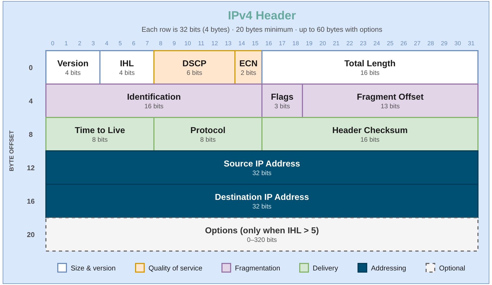

# 💻 Day 010 — IPv4 Header

**Every field in the IPv4 header, and what each one is for**

| 📅 Date | ⏱️ Time spent | 📚 Source | 🛠️ Work type |
|---|---|---|---|
| 2026-11-23 | N/A | Jeremy's IT Lab, Free CCNA Day 10 (IPv4 Header) No lab for this day ▶️ [Playlist](https://www.youtube.com/playlist?list=PLxbwE86jKRgMpuZuLBivzlM8s2Dk5lXBQ) | Lecture |

<!-- Aim for 10 minutes of writing. Copy this file to days/day-NNN/README.md. -->

> 🎯 **Goal:** Learn what each field in the IPv4 header does, and which ones a router changes on the way through.

## 📋 What I Did

- [x] **Lecture:** Watched Jeremy's IT Lab Day 10 on the IPv4 header. The course has no lab for this day.

> [!IMPORTANT]
> 🔥 **Also working on:** a firewall certification with Fortinet.

## 🧩 The IPv4 Header

  

## 🧠 Key Takeaways

### Field guide

The colors match the diagram.

| Field | Bits | What it does |
|:--|:--:|:--|
| ⬜ Version | 4 | IP version: `4` for IPv4 |
| ⬜ IHL | 4 | Header length in 4-byte rows: `5` = 20 bytes, `15` = 60 bytes |
| 🟧 DSCP | 6 | Priority marking for QoS |
| 🟧 ECN | 2 | Signals congestion without dropping packets |
| ⬜ Total Length | 16 | Header plus data, in bytes: 20 to 65,535 |
| 🟪 Identification | 16 | The same on every fragment of one original packet |
| 🟪 Flags | 3 | Reserved (always 0), DF (Don't Fragment), MF (More Fragments) |
| 🟪 Fragment Offset | 13 | Where a fragment fits in the original packet, in 8-byte units |
| 🟩 Time to Live | 8 | Each router subtracts 1, and drops the packet at 0 |
| 🟩 Protocol | 8 | What's inside: `1` ICMP, `6` TCP, `17` UDP, `89` OSPF |
| 🟩 Header Checksum | 16 | Catches errors in the header; recalculated at every hop |
| 🟦 Source / Destination IP Address | 32 each | Who sent the packet, and where it's going |
| 🔲 Options | 0–320 | Rarely used; there only when IHL is more than 5 |

- **TTL explains Day 8's `TTL=127`:** the replies [left PC2 and PC3 at 128](../day-008/README.md#task-7--ping-across-r1), and R1 subtracted 1. Every router does the same, so a packet caught in a routing loop dies instead of circling forever.
- **A router rewrites two fields at every hop:** TTL drops by 1, so the header checksum has to be recalculated.
- **IHL counts 4-byte rows, not bytes:** the five fixed rows give the 20-byte minimum.

### 🔥 Why it matters for firewalls

Firewall rules match on fields from this header (the source and destination addresses and the protocol number), plus the ports in the TCP or UDP header that comes right after it.

## 📝 Synopsis

***Day 10 of Jeremy's IT Lab.***

No lab for this day, so I studied the IPv4 header and kept working toward my Fortinet firewall certification.

---

⬅️ **Previous:** [Day 009 · Switch Interfaces](https://github.com/migyuelito/100-days-of-networking/blob/main/days/day-009/README.md) &nbsp;&nbsp;•&nbsp;&nbsp; **Next:** Day 011 · Routing Fundamentals ➡️

**[⬆ Back to top](#readme-top)**

