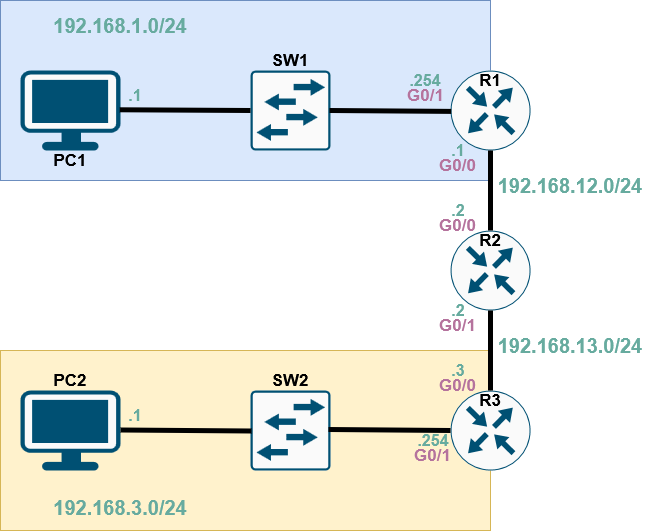
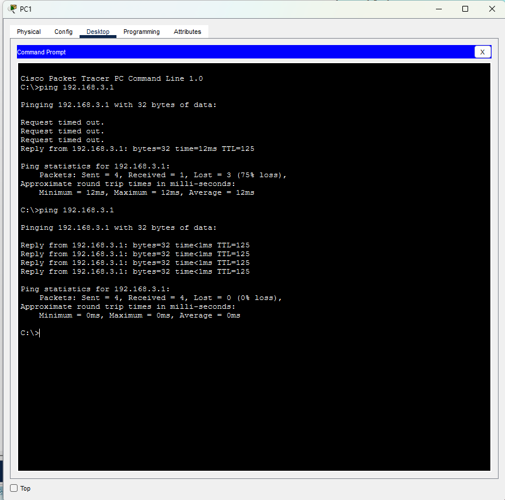
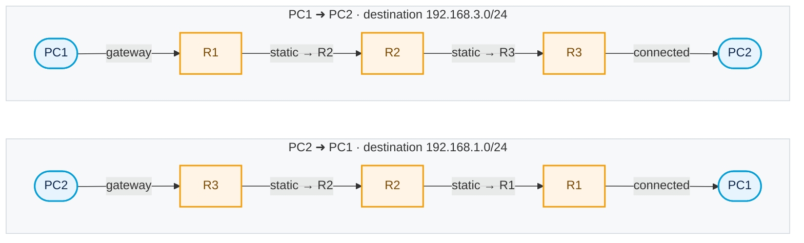

<div align="center">
<a id="readme-top"></a>

# 💻 Day 011 — Routing Fundamentals & Static Routing

**Three routers between two LANs, and the static routes that connect them**

[](https://github.com/migyuelito/100-days-of-networking)


| 📅 Date | ⏱️ Time spent | 📚 Source | 🛠️ Work type |
|---|---|---|---|
| 2026-11-24 | 13 min | Jeremy's IT Lab, Free CCNA<br>Day 11 (Routing Fundamentals & Static Routing)<br>Day 11 Lab 1 (Configuring Static Routes)<br>Day 11 Lab 2 (Troubleshooting Static Routes)<br>▶️ [Playlist](https://www.youtube.com/playlist?list=PLxbwE86jKRgMpuZuLBivzlM8s2Dk5lXBQ) | Guided |

</div>

<!-- Aim for 10 minutes of writing. Copy this file to days/day-NNN/README.md. -->

> 🎯 **Goal:** Configure static routes so PC1 and PC2 can reach each other across three routers, then troubleshoot static routes.

## 📋 What I Did

- [x] **Guided:** Followed the Day 11 Configuring Static Routes lab in Packet Tracer to set static routes.
- [x] **Guided:** Followed the Day 11 Troubleshooting Static Routes lab in Packet Tracer to troubleshoot static routes.

## 🗺️ Topology

<p align="center">
  
</p>

Two LANs at opposite ends, joined by three routers. Every network is a /24 (255.255.255.0).

**Routers**

| Router | Interface | Address | Network | Connects to |
|:--|:--|:--|:--|:--|
| R1 | G0/1 | 192.168.1.254 | 192.168.1.0/24 | SW1 (PC1's LAN) |
| R1 | G0/0 | 192.168.12.1 | 192.168.12.0/24 | R2 G0/0 |
| R2 | G0/0 | 192.168.12.2 | 192.168.12.0/24 | R1 G0/0 |
| R2 | G0/1 | 192.168.13.2 | 192.168.13.0/24 | R3 G0/0 |
| R3 | G0/0 | 192.168.13.3 | 192.168.13.0/24 | R2 G0/1 |
| R3 | G0/1 | 192.168.3.254 | 192.168.3.0/24 | SW2 (PC2's LAN) |

**Hosts**

| Host | Address | Mask | Default gateway | Connects to |
|:--|:--|:--|:--|:--|
| PC1 | 192.168.1.1 | 255.255.255.0 | 192.168.1.254 (R1) | SW1 |
| PC2 | 192.168.3.1 | 255.255.255.0 | 192.168.3.254 (R3) | SW2 |

## ✅ Lab Tasks

> **Starting state:** No device has any configuration, and the switches don't need any.

- [x] [**Task 1**](#task-1--configure-all-devices) — Configure the PCs and routers according to the network diagram (hostnames, IP addresses, etc.). Remember to configure the gateway on the PCs
- [x] [**Task 2**](#task-2--configure-static-routes) — Configure static routes on the routers to enable PC1 to successfully ping PC2

## 🏷️ Part 1 — Addresses and Gateways

### Task 1 — Configure all devices

> Configure the PCs and routers according to the network diagram (hostnames, IP addresses, etc.). Remember to configure the gateway on the PCs. You don't have to configure the switches.

💡 **My solution:** On each router, the hostname, then an address and `no shut` on both interfaces. Each PC got its address, mask, and default gateway from the Hosts table.

```
Router> en
Router# conf t
Router(config)# hostname R1
R1(config)# int g0/1
R1(config-if)# ip add 192.168.1.254 255.255.255.0
R1(config-if)# no shut
%LINK-5-CHANGED: Interface GigabitEthernet0/1, changed state to up
%LINEPROTO-5-UPDOWN: Line protocol on Interface GigabitEthernet0/1, changed state to up
R1(config-if)# int g0/0
R1(config-if)# ip add 192.168.12.1 255.255.255.0
R1(config-if)# no shut
%LINK-5-CHANGED: Interface GigabitEthernet0/0, changed state to up

Router> en
Router# conf t
Router(config)# hostname R2
R2(config)# int g0/0
R2(config-if)# ip add 192.168.12.2 255.255.255.0
R2(config-if)# no shut
%LINK-5-CHANGED: Interface GigabitEthernet0/0, changed state to up
%LINEPROTO-5-UPDOWN: Line protocol on Interface GigabitEthernet0/0, changed state to up
R2(config-if)# int g0/1
R2(config-if)# ip add 192.168.13.2 255.255.255.0
R2(config-if)# no shut
%LINK-5-CHANGED: Interface GigabitEthernet0/1, changed state to up

Router> en
Router# conf t
Router(config)# hostname R3
R3(config)# int g0/0
R3(config-if)# ip add 192.168.13.3 255.255.255.0
R3(config-if)# no shut
%LINK-5-CHANGED: Interface GigabitEthernet0/0, changed state to up
%LINEPROTO-5-UPDOWN: Line protocol on Interface GigabitEthernet0/0, changed state to up
R3(config-if)# int g0/1
R3(config-if)# ip add 192.168.3.254 255.255.255.0
R3(config-if)# no shut
%LINK-5-CHANGED: Interface GigabitEthernet0/1, changed state to up
%LINEPROTO-5-UPDOWN: Line protocol on Interface GigabitEthernet0/1, changed state to up
```

## 🧭 Part 2 — Static Routes

### Task 2 — Configure static routes

> Configure static routes on the routers to enable PC1 to successfully ping PC2.

💡 **My solution:** One route per remote LAN on each router. R1 and R3 each need a route to the LAN at the far end, and R2, in the middle, needs routes to both.

```
R1(config)# ip route 192.168.3.0 255.255.255.0 192.168.12.2     ← to PC2's LAN, via R2

R2(config)# ip route 192.168.1.0 255.255.255.0 192.168.12.1     ← back to PC1's LAN, via R1
R2(config)# ip route 192.168.3.0 255.255.255.0 192.168.13.3     ← on to PC2's LAN, via R3

R3(config)# ip route 192.168.1.0 255.255.255.0 192.168.13.2     ← back to PC1's LAN, via R2
```

📄 **Evidence:** running configs for [R1](evidence/config-static-routes/router1_config.txt), [R2](evidence/config-static-routes/router2_config.txt), and [R3](evidence/config-static-routes/router3_config.txt)

<p align="center">
  
</p>

PC1 reached PC2 across all three routers. The first ping got 1 reply out of 4, the second got all 4, and every reply shows **TTL=125**.

📄 **Evidence:** [PC1 ping screenshot](evidence/config-static-routes/ping-confirmation.png)

## 🧪 Tests

<!-- Start each Actual with ✅ (matched) or ❌ (didn't match) so results scan at a glance. -->

| Test | Expected | Actual | Evidence |
|:--|:--|:--|:--|
| T1 · PC1 pings PC2, first try | Replies once ARP has run | ✅ 1 of 4; the first three timed out | [04](evidence/config-static-routes/ping-confirmation.png) |
| T2 · PC1 pings PC2, second try | 4 of 4 replies | ✅ 4 of 4, TTL=125 | [04](evidence/config-static-routes/ping-confirmation.png) |
| T3 · Static routes saved | 1 on R1, 2 on R2, 1 on R3 | ✅ All four in the running configs | [01](evidence/config-static-routes/router1_config.txt) · [02](evidence/config-static-routes/router2_config.txt) · [03](evidence/config-static-routes/router3_config.txt) |

## 📁 Evidence

| # | File | What it shows |
|:--:|:--|:--|
| 01 | [router1_config.txt](evidence/config-static-routes/router1_config.txt) | R1's running config: addresses and its static route |
| 02 | [router2_config.txt](evidence/config-static-routes/router2_config.txt) | R2's running config: addresses and both static routes |
| 03 | [router3_config.txt](evidence/config-static-routes/router3_config.txt) | R3's running config: addresses and its static route |
| 04 | [ping-confirmation.png](evidence/config-static-routes/ping-confirmation.png) | PC1 pinging PC2 across all three routers |

## 🧠 Key Takeaways

### A route there, and a route back

Every router looks up the destination and forwards toward the next hop. The ping needs that lookup to work in both directions:



- **Connected routes come free:** a router already knows every network on its own interfaces, so only the far LANs needed static routes. R2 touches both links between the routers, so it needed routes to the two LANs and nothing else.
- **Routes are one-way:** R1's route gets PC1's ping to PC2's LAN, but PC2's reply needs R3's and R2's routes back to 192.168.1.0/24.
- **TTL=125 means three router hops:** PC2 sent its replies at 128, and R3, R2, and R1 each subtracted 1. With Day 8's single router, it was 127.
- **Three timeouts, three routers:** on the first ping, each router dropped one packet while it used ARP to find its next hop. By the second ping, every router already had its next hop's MAC address.

## 📚 Command Cheat Sheet

| Command | Where | What it does |
|:--|:--|:--|
| `enable` | User EXEC | Enter privileged EXEC mode |
| `configure terminal` | Privileged EXEC | Enter global config mode |
| `hostname <name>` | Global config | Set the device's hostname |
| `interface <name>` | Global config | Configure an interface |
| `ip address <ip> <mask>` | Interface config | Set the interface's IPv4 address and mask |
| `no shutdown` | Interface config | Enable the interface |
| `ip route <net> <mask> <next-hop>` | Global config | Add a static route to a remote network |
| `show running-config` | Privileged EXEC | Display the current configuration |
| `ping <address>` | PC → Command Prompt | Test reachability to another host |

<sub>IOS accepts any unambiguous abbreviation. The CLI output uses the short forms: `en`, `conf t`, `int`, `ip add`, and `no shut`.</sub>

## 📝 Synopsis

***Day 11 (Static Route Configuration) of Jeremy's IT Lab labs.***

Getting more hands-on in the CLI. A lot of this information I already knew.

---

<div align="center">

⬅️ **Previous:** [Day 010 · IPv4 Header](https://github.com/migyuelito/100-days-of-networking/blob/main/days/day-010/README.md) &nbsp;&nbsp;•&nbsp;&nbsp; **Next:** Day 012 · The Life of a Packet ➡️

**[⬆ Back to top](#readme-top)**

</div>
