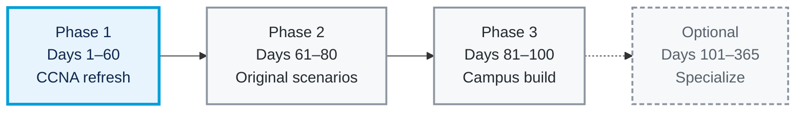

# 🧭 Roadmap

**100 days in three phases, plus an optional path to a full year**

## 🔁 Phase 1: Days 1–60, CCNA Refresh

Every day uses the loop: **guided lab → rebuild from a blank file → change a requirement or plant a fault → verify with tests → explain.**

> [!IMPORTANT]
> **Definition of done:** a day counts as done when its entry has a work type, at least two tests with expected, actual, and evidence, and one "why."

Course lesson numbers and portfolio days move at different speeds. Jeremy's IT Lab's free course runs 63 days plus a final Mega Lab. Theory-heavy lessons and the addressing and subnetting material (your strength) are compressed; design and troubleshooting topics get extra days because Phases 2 and 3 depend on them.

| Portfolio days | Course days (approx.) | Focus | Extra practice to add |
|:--|:--|:--|:--|
| 1–6 | 1–12 | Devices, cabling, OSI, the CLI, Ethernet switching, IPv4, routing basics, static routes, life of a packet | Trace one packet hop by hop in Simulation mode |
| 7 | — | 🔄 **Review day** | Rebuild a Day 4–12 lab from memory; diagnose one random fault |
| 8–13 | 13–19 | Subnetting (fast), VLANs, trunking, DTP and VTP | Design your own VLSM plan for each lab you rebuild |
| 14 | — | 🔄 **Review day** | |
| 15–20 | 20–23 | STP, Rapid STP, EtherChannel | Place the root bridge on purpose and prove it |
| 21 | — | 🔄 **Review day** | |
| 22–29 | 24–29 | Dynamic routing, RIP and EIGRP, OSPF, first hop redundancy | Fail the active gateway during a continuous ping |
| 30 | — | 🔄 **Review day** | |
| 31–34 | 30–33 | TCP and UDP, IPv6 | Dual-stack one earlier lab |
| 35–44 | 34–43 | ACLs, CDP and LLDP, NTP, DNS, DHCP, SNMP, syslog, SSH, FTP and TFTP | Write the permit and deny tests before the ACL |
| 45 | — | 🔄 **Review day** | |
| 46–49 | 44–47 | NAT, QoS | |
| 50–53 | 48–51 | Security fundamentals, port security, DHCP snooping, dynamic ARP inspection | Plug a rogue DHCP server into an access port and prove it's blocked |
| 54 | — | 🔄 **Review day** | |
| 55–57 | 52–58 | LAN and WAN architectures, virtualization and cloud, wireless (including the controller lab) | |
| 58 | 59–63 | Automation, AI and machine learning, JSON/XML/YAML, REST APIs, SDN, configuration management | Write one of your configs' VLAN plan as YAML |
| 59–60 | Mega Lab | Jeremy's CCNA Mega Lab | Plant three faults in a copy and diagnose them a day later |

> [!TIP]
> **Review days** keep skills from fading: rebuild one earlier lab from a blank file without notes, then diagnose a fault from [fault-library.md](fault-library.md) that you planted at least a day earlier. Ten minutes of the course's free Anki flashcards fits well here too.

## 🧩 Phase 2: Days 61–80, Original Scenarios

Each scenario combines switching, routing, services, and access control, and each can become a project with a summary and report.

| Scenario | Combines | Observable tests (examples) |
|:--|:--|:--|
| 🏢 **Two-site small business** Days 61–64 | OSPF, DHCP relay, central DNS, NTP, and syslog server, extended ACLs | A Site B client gets its lease from the Site A server; the syslog server receives a message when a link drops |
| 🛟 **Branch with redundant gateways** Days 65–68 | HSRP, STP root aligned with the active gateway, EtherChannel | Continuous ping survives a gateway failure; record replies lost |
| 🛡️ **Harden the access layer** Days 69–72 | Port security, DHCP snooping, dynamic ARP inspection, BPDU guard | A rogue DHCP server on a user port hands out no leases |
| 🌐 **Internet edge** Days 73–76 | PAT for users, static NAT for a published web server, ACL allowing only web traffic to it | An outside host reaches the web server; an outside SSH attempt is blocked |
| 🔍 **Troubleshooting gauntlet** Days 77–80 | Any earlier build, with five planted faults | Each fault has a written trail: symptom → hypotheses → proof → fix → retest |

## 🏫 Phase 3: Days 81–100, Campus Network in Stages

Design a small campus with **employee, guest, server, and management** segments, redundant links, and rules for which traffic is allowed. Success is defined by tests, written before you build.

**Suggested shape:** two distribution switches (multilayer) running HSRP for each user VLAN, two or three access switches each dual-homed to both distribution switches, a server segment, and an edge router toward a simulated ISP. Size each subnet from stated host counts and show the math in the report.

| Stage | Exit test (must pass before moving on) |
|:--|:--|
| 📝 Requirements, traffic matrix, addressing plan, test plan Days 81–83 | Every requirement has at least one test written down |
| 🔀 Access and distribution switching: VLANs, trunks, root placement, EtherChannel Days 84–87 | `show spanning-tree` matches the planned root for every VLAN |
| 🧭 Gateways and routing: SVIs, HSRP, OSPF to the edge Days 88–91 | Every segment reaches the server segment; HSRP active matches the STP root |
| 🔐 Services and security: DHCP, DNS, NTP, syslog, SSH-only management, ACLs, access-layer protection Days 92–94 | All allow and deny tests in the traffic matrix pass |
| 💥 Failure testing Days 95–97 | Each outage test has expected and actual results recorded |
| 🎤 Report, diagrams, interview walkthrough Days 98–100 | You can explain the design and its tests in 5 minutes |

### 🧪 Starter Test Plan

| Test | Action | Expected |
|:--|:--|:--|
| Guest to approved service | Guest PC opens the approved web server | Page loads |
| Guest to management | Guest PC pings and tries SSH to a switch management address | Both fail; the deny line's match count rises |
| Management access | Admin PC in the management VLAN opens SSH to each switch | Succeeds; SSH from any other VLAN fails |
| Uplink failure | Continuous ping from an employee PC to a server while you shut the active uplink | Recovers on its own; record replies lost |
| Gateway failure | Power off the HSRP active switch during a continuous ping | The standby takes over; record replies lost and which switch is active |
| Active session | Keep an SSH session open from the admin PC during the uplink test | Record whether it survives |
| Recovery | Restore the failed device | Record whether it takes back the active role, and whether you intended that |

> [!NOTE]
> Packet Tracer's timing isn't real time, so compare outcomes (replies lost, session survived, which device took over) rather than milliseconds. Repeat timing-sensitive tests on real IOS later if you need precise numbers. For a continuous ping, use `ping -t` on a PC, or a router's extended ping with a high repeat count if your version doesn't support it.

## 🚀 Optional: Days 101–365, Specialize

Mapped to Cisco's **ENCOR 350-401 v1.2** exam topics, the core exam for CCNP Enterprise ([official topics PDF](https://learningcontent.cisco.com/documents/marketing/exam-topics/350-401-ENCORE-v1.2.pdf)). Domain weights:

| # | Domain | Weight | |
|:--:|:--|--:|:--|
| 1.0 | Architecture | 15% | 🟦🟦🟦 |
| 2.0 | Virtualization | 10% | 🟦🟦 |
| 3.0 | Infrastructure | 30% | 🟦🟦🟦🟦🟦🟦 |
| 4.0 | Network Assurance | 10% | 🟦🟦 |
| 5.0 | Security | 20% | 🟦🟦🟦🟦 |
| 6.0 | Automation and AI | 15% | 🟦🟦🟦 |

Each 🟦 = 5%. The "ENCOR topics" column below uses these domain numbers.

> [!WARNING]
> Cisco revises exams roughly once a year, so recheck the version before you plan around it.

| Branch | Example projects | ENCOR topics | Deeper Cisco track |
|:--|:--|:--|:--|
| 🗺️ Advanced routing | Multi-area OSPF with summarization and filtering; eBGP to two simulated ISPs; policy-based routing; VRF and GRE/IPsec tunnels | 3.2, 2.2, 3.3 | [ENARSI 300-410](https://www.cisco.com/site/us/en/learn/training-certifications/exams/enarsi.html) (a CCNP Enterprise concentration) |
| 🛡️ Security | Device access with AAA; infrastructure ACLs and CoPP; segmented firewall policy on a stateful firewall | 5.1, 5.2, 5.4 | [SCOR 350-701](https://www.cisco.com/site/us/en/learn/training-certifications/exams/scor.html) (CCNP Security core) |
| 🤖 Automation | Python config backups committed to Git; JSON or YAML inventory; RESTCONF reads; an EEM applet | 6.1–6.7, 4.6 | [CCNP Automation](https://www.cisco.com/site/us/en/learn/training-certifications/certifications/automation/ccnp-automation/index.html) (formerly DevNet Professional) |
| 📈 Network operations | Syslog and SNMP monitoring; NetFlow; SPAN capture into Wireshark; IP SLA tracking; runbooks and postmortems | 4.1–4.4, 1.1.b | ENCOR itself |

### 🧪 When a Requirement Outgrows Packet Tracer

Test each feature in Packet Tracer first. When it's missing or behaves unlike real IOS, move that project:

| You need | Try | Notes |
|:--|:--|:--|
| Real IOS and IOS-XE behavior, NETCONF/RESTCONF, EEM | [Cisco Modeling Labs Free](https://developer.cisco.com/docs/modeling-labs/cml-free/) | Up to 5 nodes at once; includes Cisco images licensed for use inside CML |
| Topologies larger than 5 nodes | CML Personal (paid), GNS3, or EVE-NG Community | GNS3 and EVE-NG need device images you're licensed to use |
| Packet captures you can analyze | Wireshark on links in CML, GNS3, or EVE-NG | Packet Tracer shows packets in Simulation mode but doesn't produce capture files |
| A real stateful firewall | pfSense or OPNsense in a virtual machine | |
| Automation practice | Python with Netmiko, or Ansible, against CML devices | |
| Monitoring | A syslog server plus LibreNMS or Zabbix | Good overlap with the home lab repo |

---

⬅️ **[Back to README](../README.md)** &nbsp;&nbsp;•&nbsp;&nbsp; **[⬆ Back to top](#readme-top)**

